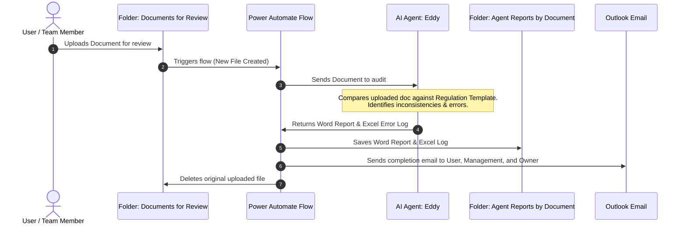

# Flow Automation Blueprint & Replication Guide
**Decoupled Workflow for Document Compliance Review, Reporting, and Alerts**

This blueprint defines the architecture and implementation details for a document-based compliance review workflow. It is designed to be easily replicated or adapted by the team for other review processes.

---

## 1. System Process & Architecture
The core design pattern of this system is **decoupling orchestration from intelligence**.
* **Orchestration (Power Automate):** Triggers when a file is uploaded, transfers files, sends notifications, and cleans up the input folder.
* **Intelligence (AI Agent - Eddy):** Compares the uploaded document against a specific **Regulation Template** (which outlines rules, regulations, and structure), detects errors/inconsistencies, and generates the reports.

### Folder Structure
* **`Documents for Review`**: The ingestion folder where users upload documents that need auditing.
* **`Agent Reports by Document`**: The output folder where the generated reports are stored.

### Step-by-Step Execution Flow

---

## 2. Core Flow (Power Automate) Specification

### Trigger
* **SharePoint / OneDrive:** *When a file is created (properties only)* in the `Documents for Review` folder.

### Actions Sequence
1. **Get File Content:** Retrieve the uploaded document.
2. **Call AI Agent (Eddy):** Pass the file content to Eddy.
   * *Agent Action:* Eddy matches the file against the standard **Regulation Template** to find deviations.
   * *Agent Output:* Eddy outputs two finished files:
     * A **Word Document (.docx)** containing the detailed review report.
     * A **Spreadsheet (.xlsx)** containing the structured error log.
3. **Save Reports:** Save both the Word report and the Excel error log to the `Agent Reports by Document` folder.
4. **Email Notification:** Send a completion email with links to the generated reports to:
   * **The User** (who uploaded the file).
   * **The User's Management** (for visibility).
   * **The System Owner** (for admin tracking).
5. **File Cleanup:** Delete the original file from the `Documents for Review` folder.

---

