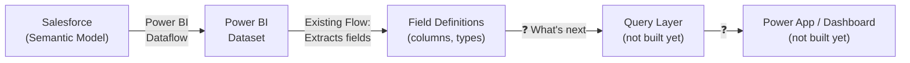
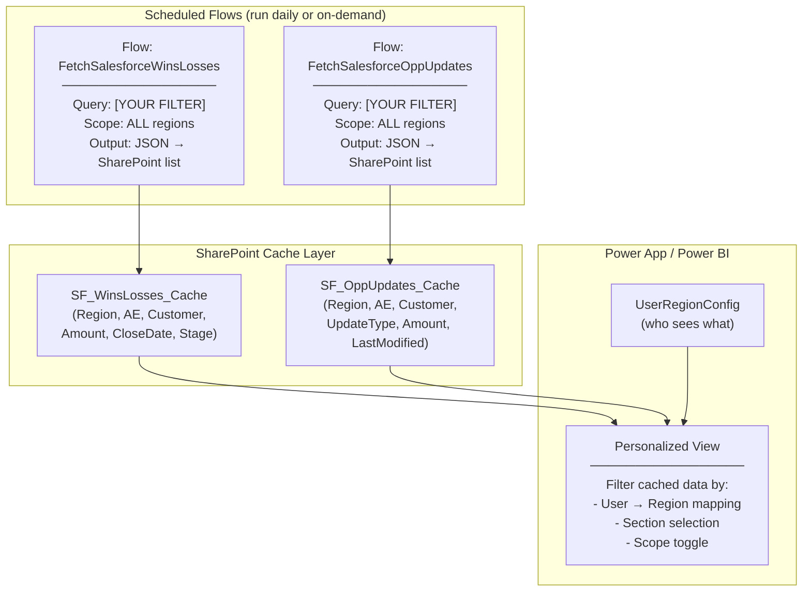
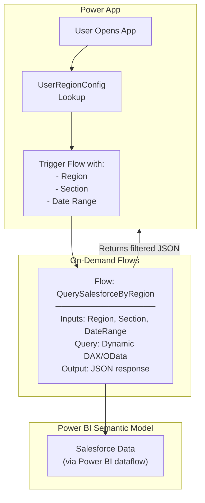
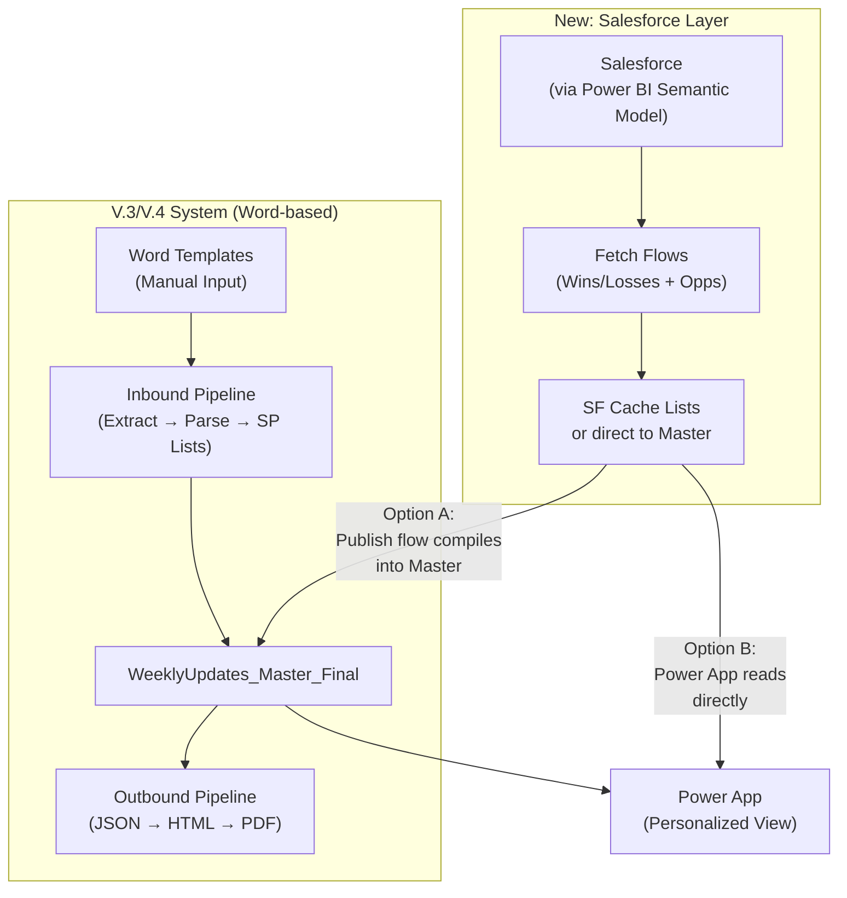

# Salesforce → Power BI Data Fetching: Architecture Framework

This document organizes the **decisions you need to make** and the **dimensions you need to define** before building out the remaining flows. It's not a build plan — it's the thinking structure to help you land on the right architecture.

---

## Where You Are Now



**What exists:**
- A flow that connects to the Salesforce semantic model via Power BI and extracts the field schema (what columns/measures are available)
- Your V.3/V.4 architecture for the weekly report (SharePoint-based inbound/outbound pipelines)

**What's missing:**
- The query layer — *how* you actually pull wins/losses and opportunity updates from the semantic model
- The filtering/routing logic — *who* sees *what* based on region, AE, team, section
- The data delivery pattern — *when* and *how often* data gets fetched

---

## The 3 Big Architecture Decisions

These are the questions that determine your flow design. You don't need to answer all of them right now, but you do need to know what you're choosing between.

### Decision 1: Fetch Strategy — All-at-Once vs. Per-Request

| Strategy | How It Works | Pros | Cons |
|:---|:---|:---|:---|
| **All-at-Once (Batch)** | A scheduled flow queries ALL wins/losses + opps for ALL regions, stores the full dataset (e.g., in a SharePoint list or Excel), then the app reads from the stored copy | Simple query logic; app loads fast because data is local; one API call | Data can be stale between refreshes; bigger payload per run |
| **Per-Request (On-Demand)** | The app (or a flow triggered by the app) queries the semantic model in real time when a user opens their view | Always current data; only fetches what's needed | More API calls; slower perceived load time; more complex flow logic |
| **Hybrid** | A scheduled flow fetches the full dataset periodically (e.g., every 4 hours or every morning). The app reads from the cached copy, but a user can hit a "Refresh" button to trigger a live pull | Best of both worlds; current enough for most use cases | Most complex to build; need cache invalidation logic |

> [!IMPORTANT]
> **What you need to decide:**
> How fresh does the data need to be? If the weekly report is Friday-based and people mostly look at this during the week, a daily or twice-daily batch may be enough. If people need real-time Salesforce data, you need per-request.

---

### Decision 2: Query Scope — What Exactly Are You Pulling?

You mentioned two sections: **Wins/Losses** and **Opportunity Updates**. Before building queries, define the exact filter logic for each.

#### Section: Wins / Losses
| Filter Dimension | Question to Answer | Example |
|:---|:---|:---|
| **What defines a "win"?** | Is it stage = Closed Won? A specific lifecycle stage? | `Stage = 'Closed Won'` |
| **What defines a "loss"?** | Stage = Closed Lost? Or something else? | `Stage = 'Closed Lost'` |
| **Time window** | Wins/losses since when? This week? Last 7 days? Since last report date? | `CloseDate >= last Friday` |
| **Region filter** | How is region identified in Salesforce? Account Owner's region? A custom field? | `Region__c` or inferred from Account Owner |
| **Account Executive** | Is this the Opportunity Owner or the Account Owner? | `OwnerId` lookup |

#### Section: Opportunity Updates
| Filter Dimension | Question to Answer | Example |
|:---|:---|:---|
| **What counts as an "update"?** | Any opp modified since last report? Stage change? Amount change? | `LastModifiedDate >= last Friday` |
| **Which stages?** | All open opps? Only specific stages? | `Stage NOT IN ('Closed Won', 'Closed Lost')` |
| **What fields changed?** | Do you need to know *what* changed, or just that something changed? | Field history tracking in SF |
| **Region / AE filters** | Same as wins/losses? | Same mapping |

> [!IMPORTANT]
> **What you need to define:**
> Write out the DAX or OData query filter logic for each section. This is the core of your query layer — everything else (routing, permissions, caching) builds on top of these two queries.

---

### Decision 3: Personalization Model — Who Sees What

This is about routing the data to the right person. You already have the `UserRegionConfig` list from your V.4 plan — the question is how to extend it for the Salesforce layer.

#### Personalization Dimensions

```
┌────────────────────────────────────────────────────────┐
│                  WHO IS LOOKING?                       │
│                                                        │
│  ┌──────────────┐  ┌──────────────┐  ┌──────────────┐ │
│  │   Person      │  │   Team       │  │   Region     │ │
│  │              │  │              │  │              │ │
│  │ Patrick      │  │ Sales Ops    │  │ AT&T         │ │
│  │ Danielle     │  │ Marketing    │  │ Canada       │ │
│  │ Jacob        │  │ Commercial   │  │ Verizon      │ │
│  │ George       │  │              │  │ NSP          │ │
│  │ Christian    │  │              │  │ Verticals    │ │
│  └──────────────┘  └──────────────┘  └──────────────┘ │
│                                                        │
│                  WHAT DO THEY SEE?                      │
│                                                        │
│  ┌──────────────┐  ┌──────────────┐                   │
│  │   Section     │  │   Scope      │                   │
│  │              │  │              │                   │
│  │ Wins/Losses  │  │ My Deals     │                   │
│  │ Opp Updates  │  │ My Region    │                   │
│  │              │  │ All Regions  │                   │
│  └──────────────┘  └──────────────┘                   │
└────────────────────────────────────────────────────────┘
```

#### The Mapping Table You Need to Build

This extends your existing `UserRegionConfig` concept to include Salesforce-specific mappings:

| Config Field | Purpose | Example |
|:---|:---|:---|
| `UserEmail` | Who | `patrick@fujitsu.com` |
| `Region` | Their primary region(s) | `AT&T` |
| `Team` | Their team | `Sales Ops` |
| `Role` | Access level | `Analyst`, `Manager`, `Executive` |
| `DefaultSections` | What sections they see by default | `Wins/Losses, Opp Updates` |
| `DefaultScope` | Default view scope | `MyRegion` |
| `SF_OwnerIds` | Salesforce user IDs for "My Deals" filtering | `005xxxxx` (optional) |

> [!IMPORTANT]
> **What you need to decide:**
> - Should the config table live in SharePoint (like `UserRegionConfig`), or should it be derived from Salesforce itself (e.g., user roles in SF)?
> - Is the mapping Region → AE fixed, or can one AE cover multiple regions?
> - Does "My Region" mean "deals where I'm the AE" or "deals in the geographic region I'm assigned to"?

---

## The Flow Architecture You Need to Define

Based on the three decisions above, here's the skeleton of flows you'll need. **Your job is to fill in the blanks** based on your decisions.

### Option A: Batch Architecture (Recommended to start)



### Option B: Per-Request Architecture



---

## What You Need to Deliver Next (Your Checklist)

These are the concrete next steps — not the build, but the **definitions** that make the build possible.

### ☐ 1. Define Your Two Core Queries
For each section (Wins/Losses and Opp Updates), write out:
- The exact Salesforce fields you're pulling
- The filter conditions (stage, date, region)
- How you identify "region" and "AE" in the semantic model
- The date logic (rolling 7 days? since last Friday? configurable?)

### ☐ 2. Pick Your Fetch Strategy
- Batch, Per-Request, or Hybrid?
- If batch: how often? (daily, twice daily, on-demand + scheduled)
- If per-request: can the Power BI semantic model handle concurrent queries from multiple users?

### ☐ 3. Map Your Users to Their Data
- Confirm the Region → Person mapping
- Decide: can a person be assigned to multiple regions?
- Decide: do managers (Christian) see all regions or just a rollup?
- Decide: where does this config live? (extend `UserRegionConfig` or new list?)

### ☐ 4. Define the Cache Schema (if going batch)
- What columns does the cache SharePoint list need?
- Should it mirror your existing `NewWinsSignificantLosses` / `NewOpportunitiesUpdates` schema, or does the Salesforce data have different fields?
- Retention: do you keep historical cache data or overwrite each run?

### ☐ 5. Map This to Your Existing V.4 Architecture
- Does this **replace** the Word-document inbound pipeline for the Salesforce-sourced data?
- Or does it run **alongside** it (Salesforce data + manual Word entries both feeding the Master list)?
- How does it connect to the outbound PDF pipeline?

---

## How This Fits With What You Already Have



> [!TIP]
> **The cleanest integration**: The Salesforce fetch flows write to cache lists that mirror your staging schema. A Publish flow compiles them into the Master list alongside the Word-sourced data. The PDF generator and Power App both read from Master — they don't care where the data originated.

---

## Questions for You

These aren't design questions — they're the things only you can answer because they depend on your business context:

1. **How is "region" represented in your Salesforce semantic model?** Is it a field on the Opportunity? On the Account? Derived from the Account Owner?

2. **What fields does your existing Power BI flow extract?** Can you share the field list output from the flow you already built? That'll tell us exactly what's queryable.

3. **Do the Salesforce-sourced updates replace the Word-document updates for sales, or are they different data?** (e.g., Word = narrative commentary, Salesforce = structured deal data)

4. **Who needs real-time vs. "close enough"?** If Patrick checks Monday morning for AT&T updates, is data from Sunday night good enough? Or does he need to see an opp that changed 5 minutes ago?

5. **Are there AEs or regions you want to start with as a pilot?** (e.g., just AT&T / Patrick first, then roll out to Canada, Verizon, etc.)
