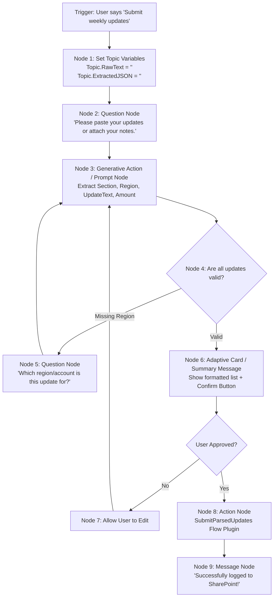

# Copilot Studio Implementation Guide
## Architectural Best Practices & Step-by-Step Build Guide for the Sales Update Agent

> [!NOTE]
> For the **EDDY Senior Technical Copy Editor Agent (DCM-100 Compliance Engine)**, please refer to the dedicated [EDDY - Technical Copy Editor Agent Blueprint.md](file:///c:/Users/AlarconL/OneDrive%20-%20FUJITSU/Americas%20-%201Finity%20Sales%20Operations%20Team%20-%20Sales%20Weekly%20Workflow%20Automation/Documentation/EDDY%20-%20Technical%20Copy%20Editor%20Agent%20Blueprint.md).

This guide provides deep technical instructions for building the **Sales Weekly Update Intake Agent** inside **Microsoft Copilot Studio**, based on the PRD specification.

---

## 1. Core Architectural Pillars in Copilot Studio

When building an enterprise data-intake agent in Copilot Studio, follow these 4 architectural pillars:

```text
+-----------------------------------------------------------------------------------+
| 1. System Prompt & Identity : Controls tone, domain boundaries, & guardrails      |
| 2. Custom Entities          : Machine-teaches Copilot your domain terms (Accounts)|
| 3. State & Variable Scope   : Controls context memory across nodes & topics       |
| 4. Deterministic Action Tool: Safely dispatches verified JSON to Power Automate   |
+-----------------------------------------------------------------------------------+
```

---

## 2. Step 1: System Instructions & Agent Identity

In Copilot Studio under **Settings > General Instructions**, set the foundational identity prompt:

```text
You are "Eddy", the 1FINITY Sales Operations Weekly Report Assistant. 
Your sole purpose is to receive weekly sales updates from account leads, extract structured sales data, and log it to the Sales Ops database.

GUIDELINES:
1. Every update MUST belong to one of two sections: "Win / Loss" or "Opportunity".
2. Every update MUST be assigned to an Account/Region (e.g., AT&T, Verizon, Horizon, Named Service Providers).
3. If an account is unclear, ask the user to clarify before submitting.
4. Be concise, professional, and encouraging.
5. NEVER execute the SubmitUpdates flow action until the user visually confirms the extracted updates summary.
```

---

## 3. Step 2: Define Custom Entities (Slot Filling)

Creating **Custom Entities** teaches Copilot to recognize domain-specific terms (like your sales regions) automatically out of raw conversation.

### Entity A: `AccountRegionEntity`
* **Type**: Closed List (with synonyms)
* **Items & Synonyms**:
  * `AT&T` -> Synonyms: *ATT, AT and T, Mobility, Core Network*
  * `Verizon` -> Synonyms: *VZW, VZ, Verizon Wireless*
  * `Horizon` -> Synonyms: *Horizon Telecom, Horizon Net*
  * `Named Service Providers` -> Synonyms: *NSP, Tier 2s, Service Providers*

### Entity B: `ReportSectionEntity`
* **Type**: Closed List
* **Items & Synonyms**:
  * `Win / Loss` -> Synonyms: *Wins, Losses, Won, Lost, Closed Deal*
  * `Opportunity` -> Synonyms: *Opps, Pipeline, Proposal, Trial, Pitch*

---

## 4. Step 3: Designing the Main Intake Topic ("Submit Weekly Update")

### Trigger Phrases:
Add 5-10 natural trigger phrases:
* *Submit weekly updates*
* *Log my wins for AT&T*
* *I have new sales updates for this week*
* *Add opportunities to the weekly report*
* *Upload my sales bullets*

---

### Node-by-Node Canvas Flow Architecture



---

## 5. Master Prompt for the Generative Extraction Node

Inside your Topic, add a **Create generative answers** or **Prompt Node** named `ExtractSalesUpdatesPrompt`:

### Prompt Text:
```text
Analyze the following user input and extract all sales updates.

User Input: {Topic.RawInput}

Instructions:
1. For each update, classify the Section as exactly "Win / Loss" or "Opportunity".
2. Identify the Account/Region. Must be one of: "AT&T", "Verizon", "Horizon", "Named Service Providers". If unknown, set to "UNKNOWN".
3. Extract the clean UpdateText summarizing the milestone.
4. Extract any dollar amount if mentioned (numeric only, e.g., 500000). If none, set to null.

Output raw JSON array strictly matching this format:
[
  {
    "Section": "Win / Loss",
    "Region": "AT&T",
    "UpdateText": "Won $500k expansion deal",
    "Amount": 500000
  }
]
```

---

## 6. Managing Variables & Session Memory

Understanding variable scope prevents data bleeding between different users or topic restarts:

| Variable Name | Scope | Purpose |
| :--- | :--- | :--- |
| `Topic.RawInput` | **Topic** | Stores the raw text/file text provided in the current turn. |
| `Topic.ParsedJSON` | **Topic** | Stores the temporary JSON array returned by the extraction prompt. |
| `Global.UserEmail` | **Global (System)** | `User.Email` (automatically populated by Teams single-sign-on). |
| `Global.SessionUpdates` | **Global** | Holds cumulative updates if the user submits multiple batches in one chat. |

---

## 7. Power Automate Plugin Action Setup

In Copilot Studio, click **Add Action > Flow**, and connect your Power Automate flow:

### Action Name: `SubmitParsedUpdates`
* **Inputs to Flow**:
  * `UpdatesJSON` = `Topic.ParsedJSON`
  * `UserEmail` = `System.User.Email`
* **Outputs from Flow**:
  * `Status` = `"Success"`
  * `ItemsCreatedCount` = `2`

---

## 8. Summary Checklist for Building in Copilot Studio

- [ ] Create the **Copilot Agent** in Copilot Studio connected to Microsoft Teams.
- [ ] Add the 2 **Custom Entities**: `AccountRegionEntity` and `ReportSectionEntity`.
- [ ] Create the main Topic: **Submit Weekly Update**.
- [ ] Add the **Prompt Extraction Node** using the JSON extraction prompt.
- [ ] Build the **Confirmation Adaptive Card** for visual user approval.
- [ ] Link the **Power Automate Flow Plugin Action** (`SubmitParsedUpdates`).
- [ ] Test end-to-end directly inside Copilot Studio test canvas!
