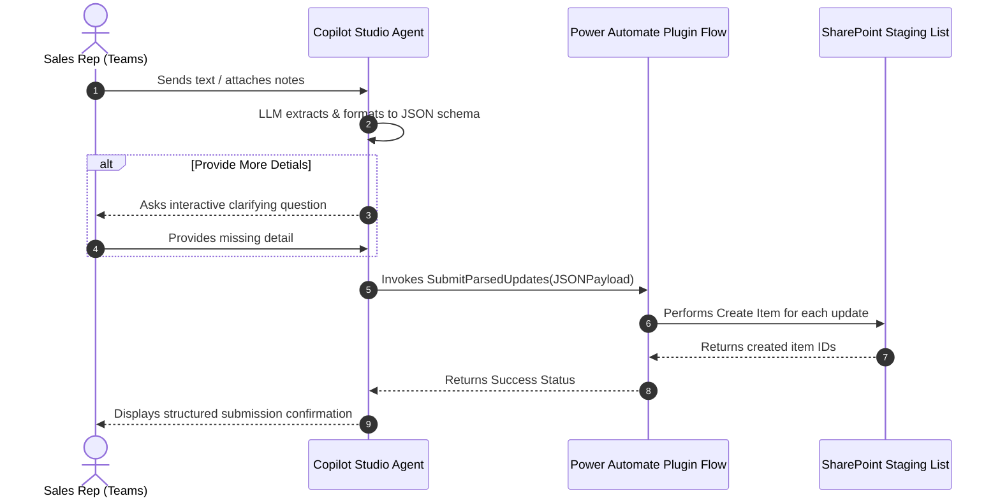

# Product Requirement Document (PRD)
## AI Chat Layer Subsystem (Copilot Studio Intake Engine)

| Document Attribute | Details |
| :--- | :--- |
| **System Component** | Subsystem 1: Conversational Intake & Data Structuring Layer |
| **Parent Architecture**| Sales Weekly Workflow Automation |
| **Document Version** | 1.0 |
| **Target Audience** | Sales Operations Team, Engineering / Flow Developers, Stakeholders |
| **Status** | Proposed Architecture |

---

## 1. Executive Summary & Problem Statement

### 1.1 Executive Summary
The **AI Chat Layer Subsystem** serves as the primary conversational intake interface for the Sales Weekly Workflow. Operating natively within Microsoft Teams via Microsoft Copilot Studio, this subsystem replaces legacy, rigid Word document formatting and XML parsing with a natural language AI interface. It ingests unstructured text, bullet points, pasted emails, or uploaded notes from sales leads, converts the information into validated, structured JSON payloads, and automatically dispatches the data to the SharePoint Staging Database.

### 1.2 Problem Statement
Under the legacy document-first architecture:
* **User Friction**: Sales reps and regional managers must adhere to strict formatting rules (specific content controls, bold headings for region names, standardized bullet styles) when writing weekly updates. Any deviation breaks parsing logic.
* **Fragile Backend Logic**: Extracting and parsing raw `word/document.xml` requires complex unzipping, race-condition management, and brittle XPath queries in Power Automate.
* **Lack of Real-Time Validation**: Errors or missing fields (e.g., unspecified region or missing deal amount) are only discovered late in the weekly cycle during manual sales ops review.

---

## 2. Goals & Strategic Objectives

1. **Zero User Formatting**: Enable sales reps to submit updates naturally via chat (text, bullets, pasted email snippets, or uploaded draft documents) without adhering to rigid Word formatting rules.
2. **AI-Native Data Normalization**: Utilize Copilot Studio's LLM capabilities to extract, clean, and map unstructured updates into a standardized JSON schema.
3. **Interactive Validation**: Provide immediate, conversational feedback to users if key attributes (e.g., Region/Account name or Section type) are ambiguous or missing. Can also be used to help get deeper understandings on deals and Opportunites.
4. **Seamless Downstream Funneling**: Automatically write structured updates directly to the central **SharePoint Staging List** via a lightweight Power Automate plugin flow, bypassing all document unzipping/XML parsing.

---

## 3. User Experience & Personas

### 3.1 Target Personas
* **Account Leads / Sales Managers**: Submit weekly wins, losses, and deal updates.
* **Sales Operations Analyst** : Audits and reviews consolidated data in SharePoint/WordDocument before executive publishing.
* **Executive Leadership**: Consumes the consolidated weekly report.

### 3.2 Key User Flows

#### Flow A: Conversational Quick Update (Microsoft Teams)
```text
User: "Here are my updates for AT&T: Won a $500k optical expansion deal. Also pitching a ROADM upgrade next Tuesday for Horizon."

Agent: "Thanks! I've categorized 2 updates:
        1. [Win/Loss] AT&T - Won $500k optical expansion deal ($500,000)
        2. [Opportunity] Horizon - Pitching ROADM upgrade next Tuesday

        Should I log these to the weekly staging list?"

User: "Yes, go ahead."

Agent: "Successfully logged 2 updates to SharePoint!"
```

#### Flow B: Document / Notes Upload
```text
User: [Attaches Notes.docx or pastes email thread] "Extract my weekly updates from this."

Agent: Parses document text natively -> Extracts Region, Section, and Bullet Points -> Prompts for confirmation -> Dispatches to SharePoint.
```

---

## 4. Functional Requirements (FR)

| ID | Requirement | Description | Priority |
| :--- | :--- | :--- | :--- |
| **FR-1** | **Intent Recognition** | The agent must recognize triggers related to weekly report submissions (e.g., "submit update", "weekly wins", "add opportunity"). | High (P0) |
| **FR-2** | **Section Categorization** | Automatically categorize each update into one of two core sections: `Win / Loss` or `Opportunity`. | High (P0) |
| **FR-3** | **Region / Account Mapping** | Detect and map the account/region entity. Default to "General" if ambiguous. Ask user for further details if insufficient update| High (P0) |
| **FR-4** | **Data Normalization** | Clean informal text, strip spelling markup/noise, and extract monetary values (`Amount`) where present. | Medium (P1) |
| **FR-5** | **Interactive Clarification** | Prompt the user interactively if a required field is missing or uncertain before dispatching. | Medium (P1) |
| **FR-6** | **Plugin Flow Dispatch** | Trigger the Power Automate flow tool `SubmitParsedUpdates` passing the validated JSON array. | High (P0) |
| **FR-7** | **Submission Confirmation** | Return a structured summary response confirming the items created in SharePoint with direct links. | High (P0) |

---

## 5. Technical Architecture & Data Schema

### 5.1 Subsystem Sequence Diagram



### 5.2 Target JSON Data Contract (`UpdatesJSON`)

The AI Chat Layer must produce a JSON array conforming to this schema contract before calling the dispatch flow:

```json
{
  "ReportDate": "2026-07-24",
  "SubmittedBy": "user@fujitsu.com",
  "Updates": [
    {
      "Section": "Win / Loss",
      "Region": "AT&T",
      "Customer": "AT&T Core Network",
      "UpdateText": "Won $500k optical expansion deal for core network upgrade.",
      "Amount": 500000.00
    },
    {
      "Section": "Opportunity",
      "Region": "Horizon",
      "Customer": "Horizon Telecom",
      "UpdateText": "Pitching next-gen ROADM node upgrade next Tuesday.",
      "Amount": null
    }
  ]
}
```

---

## 6. Non-Functional Requirements (NFR)

* **NFR-1: Responsiveness**: End-to-end processing time from chat submission to confirmation must be under **6 seconds**.
* **NFR-2: Security & Authorization**: Leverage native M365 authentication. Users can only log updates under their authorized accounts/teams.
* **NFR-3: Auditing & Transparency**: Every update logged to SharePoint must store `Created By`, `Submission Method` (`Copilot Chat`), and original raw text prompt for auditability.
* **NFR-4: Fallback**: If LLM extraction confidence is low, the agent presents an editable draft table to the user in chat before sending.

---

## 7. Dependencies & System Integration

* **Upstream**: Microsoft Teams, M365 Copilot Studio.
* **Downstream Subsystems**:
  * **Subsystem 2 (SharePoint Staging Database)**: Receives and stores all individual entries.
  * **Subsystem 3 (Friday's weekly report Generator)**: Consolidates entries from SharePoint into the master executive Word/PDF weekly report for leadership.

---

## 8. Success Metrics & KPIs

1. **User Adoption Rate**: > 85% of weekly updates submitted via Teams Chat vs. legacy email/Word uploads within 2 weeks of launch.
2. **Zero Parsing Failure Rate**: 0% XML unzipping or XPath extraction errors (due to total elimination of Legacy version).
3. **Time to Consolidated Draft**: Reduction of weekly Sales Ops report compilation time from **3-4 hours down to < 15 minutes**.
