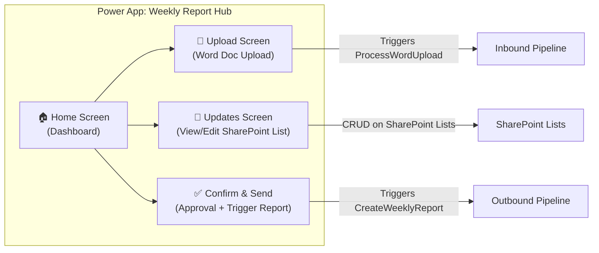
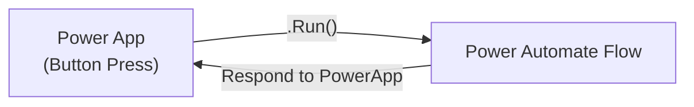

# Power App for Weekly Report Automation

Build a Power App that serves as the **central hub** for the weekly report workflow — where teams upload Word documents, review/edit updates in a SharePoint list, confirm readiness, and trigger report generation — all from a single interface.

---

## Your Current System (What We're Building On)

Based on your existing architecture, you already have:

| Component | Status | Details |
| :--- | :--- | :--- |
| **Inbound Pipeline** | ✅ Built | `ProcessWordUpload` → `ExtractWordData` → `ParseWordWeeklyUpdates` → SharePoint Lists |
| **Outbound Pipeline** | ✅ Built | `GetWeeklyReportDataset` → `ConvertJSONtoHTML` → PDF Report |
| **SharePoint Lists** | ✅ Built | `NewWinsSignificantLosses` + `NewOpportunitiesUpdates` |
| **Word Templates** | ✅ Built | Sales_Mkting WK Template with content controls |
| **Power App** | ❌ Not built | **This is what we're creating** |

The Power App will **wrap around** your existing flows and lists — not replace them.

---

## What the Power App Will Do

The app has **4 core capabilities**, each as a screen:



### Screen 1: Home Dashboard
- Shows which teams have submitted for the current week (based on SharePoint list data)
- Displays the current week's date and submission deadline
- Quick-nav tiles to Upload, View Updates, and Confirm

### Screen 2: Word Document Upload
- File upload control where teams select their `.docx` file
- Triggers your existing `ProcessWordUpload` flow (passing the file as Base64)
- Shows a progress/status indicator while the flow runs
- On success: navigates to the Updates screen to review what was extracted

### Screen 3: View & Edit Updates (SharePoint List)
- A gallery/table connected directly to your `NewWinsSignificantLosses` and `NewOpportunitiesUpdates` lists
- Filtered to the current week's `ReportDate`
- Allows inline editing (fix typos, update amounts) or adding new items manually
- Delete individual items
- This is your **manual entry fallback** — if someone can't upload a Word doc, they can type updates here directly

### Screen 4: Confirm & Generate Report
- Shows a summary of all updates for the week (count by team/region)
- A confirmation toggle per team: "Bill's Team ✅", "CAM Team ✅", "Marketing ⬜"
- A "Generate Weekly Report" button that triggers your existing `CreateWeeklyReport` flow
- Status indicator showing when the report is complete

---

## How to Build It: Step-by-Step Guide

### Phase 1: Create the App & Connect Data Sources

#### Step 1: Open Power Apps
1. Go to [make.powerapps.com](https://make.powerapps.com)
2. Click **+ Create** → **Blank app** → **Blank canvas app**
3. Name it: `Weekly Report Hub`
4. Format: **Tablet** (recommended for dashboard-style apps; Phone works too)
5. Click **Create**

#### Step 2: Add Data Sources
In the left panel, click the **Data** icon (cylinder), then **+ Add data**:

1. **SharePoint** → Connect to your site → Select:
   - `NewWinsSignificantLosses`
   - `NewOpportunitiesUpdates`
2. **Power Automate** → This is how you'll trigger your flows from the app (covered in Phase 3)

> [!IMPORTANT]
> Your SharePoint lists are already built. The Power App reads/writes to them directly using the SharePoint connector — no additional setup needed for the data layer.

---

### Phase 2: Build the Screens

#### Screen 1: Home Dashboard

1. **Insert → Screen → Blank Screen**. Rename to `scrHome`.
2. Add a **Label** at the top: `"Weekly Report Hub"` (set Font size 28, Bold).
3. Add a **Label** showing the current week:
   ```
   Text: "Week Ending: " & Text(
       DateAdd(Today(), 5 - Weekday(Today(), StartOfWeek.Monday), TimeUnit.Days),
       "MM/dd/yyyy"
   )
   ```
4. Add **3 status cards** (Rectangles + Labels) for each team. For each card:
   - **Label Text** (e.g., for Bill's Team):
     ```
     If(
         CountRows(
             Filter(
                 NewWinsSignificantLosses,
                 ReportDate = Text(
                     DateAdd(Today(), 5 - Weekday(Today(), StartOfWeek.Monday), TimeUnit.Days),
                     "yyyy-MM-dd"
                 )
             )
         ) > 0,
         "✅ Submitted",
         "⬜ Pending"
     )
     ```
   - Set the Fill color conditionally:
     ```
     If(/* same condition as above */, ColorValue("#E8F5E9"), ColorValue("#FFF3E0"))
     ```
5. Add **3 navigation buttons** (or tiles):
   - "Upload Word Doc" → `Navigate(scrUpload, ScreenTransition.Fade)`
   - "View Updates" → `Navigate(scrUpdates, ScreenTransition.Fade)`
   - "Confirm & Send" → `Navigate(scrConfirm, ScreenTransition.Fade)`

---

#### Screen 2: Upload Word Document

1. **Insert → Screen → Blank Screen**. Rename to `scrUpload`.
2. Add an **Attachments control** (from the Insert menu → Input → Attachments).
   - This control lets users browse and select a file.
3. Add a **"Upload & Process" Button**.
   - **OnSelect** property (triggers your Power Automate flow — see Phase 3):
     ```
     Set(varProcessing, true);
     Set(
         varFlowResult,
         ProcessWordUpload.Run(
             {
                 file: {
                     name: First(AttachmentControl.Attachments).Name,
                     contentBytes: First(AttachmentControl.Attachments).Value
                 }
             }
         )
     );
     Set(varProcessing, false);
     Notify("Updates extracted successfully!", NotificationType.Success);
     Navigate(scrUpdates, ScreenTransition.Fade)
     ```
4. Add a **Loading spinner** (visible when `varProcessing = true`):
   - Insert a Label: `"Processing your document..."` with `Visible: varProcessing`
5. Add a **Back button**: `Navigate(scrHome, ScreenTransition.Fade)`

> [!TIP]
> **About the file upload**: Power Apps uses an "Attachments" control that produces file content as binary. Your `ProcessWordUpload` flow's trigger needs to accept this. We'll configure the flow trigger in Phase 3.

---

#### Screen 3: View & Edit Updates

1. **Insert → Screen → Blank Screen**. Rename to `scrUpdates`.
2. Add a **Tab control** or two buttons to toggle between "Wins" and "Opportunities":
   ```
   // Toggle variable
   OnSelect (Wins button): Set(varActiveTab, "Wins")
   OnSelect (Opps button): Set(varActiveTab, "Opps")
   ```
3. Add a **Gallery** (Insert → Layout → Blank vertical gallery). Rename to `galUpdates`.
   - **Items property**:
     ```
     If(
         varActiveTab = "Wins",
         Filter(
             NewWinsSignificantLosses,
             ReportDate = Text(
                 DateAdd(Today(), 5 - Weekday(Today(), StartOfWeek.Monday), TimeUnit.Days),
                 "yyyy-MM-dd"
             )
         ),
         Filter(
             NewOpportunitiesUpdates,
             ReportDate = Text(
                 DateAdd(Today(), 5 - Weekday(Today(), StartOfWeek.Monday), TimeUnit.Days),
                 "yyyy-MM-dd"
             )
         )
     )
     ```
   - Inside the gallery, add Labels/TextInputs for:
     - `Title` (Region)
     - `CustomerName`
     - `UpdateText`
     - `Amount`
   - Add an **Edit icon** → Opens a form to edit the item
   - Add a **Delete icon** → `Remove(NewWinsSignificantLosses, ThisItem)` (or the Opps list)

4. **Manual Add Form**: Add a button "➕ Add Update" that shows an edit form:
   - **Insert → Form → Edit Form**. Connect to `NewWinsSignificantLosses`.
   - Set `DefaultMode: FormMode.New`
   - Pre-populate `ReportDate` with the current Friday:
     ```
     Default for ReportDate field:
     Text(
         DateAdd(Today(), 5 - Weekday(Today(), StartOfWeek.Monday), TimeUnit.Days),
         "yyyy-MM-dd"
     )
     ```
   - **Submit button OnSelect**: `SubmitForm(EditForm1); Notify("Update added!", NotificationType.Success)`

5. Add a **Back button**.

> [!IMPORTANT]
> **This is your manual fallback**. If a team can't upload a Word doc (or if they just need to add one or two quick updates), they can type them directly into this screen. It writes to the same SharePoint lists your flows use — so the outbound pipeline picks them up automatically.

---

#### Screen 4: Confirm & Send

1. **Insert → Screen → Blank Screen**. Rename to `scrConfirm`.
2. Add a **Summary section** showing counts:
   ```
   // Wins count
   "Wins: " & CountRows(
       Filter(NewWinsSignificantLosses,
           ReportDate = varCurrentFriday
       )
   ) & " items"
   ```
   ```
   // Opportunities count  
   "Opportunities: " & CountRows(
       Filter(NewOpportunitiesUpdates,
           ReportDate = varCurrentFriday
       )
   ) & " items"
   ```
3. Add **3 Toggle controls** for team confirmation:
   - "Bill's Team Ready" → `Set(varBillReady, Toggle1.Value)`
   - "CAM Team Ready" → `Set(varCAMReady, Toggle2.Value)`
   - "Marketing Ready" → `Set(varMktgReady, Toggle3.Value)`
4. Add a **"Generate Weekly Report" Button**:
   - **DisplayMode**:
     ```
     If(varBillReady And varCAMReady And varMktgReady,
         DisplayMode.Edit,
         DisplayMode.Disabled
     )
     ```
   - **OnSelect**:
     ```
     Set(varGenerating, true);
     CreateWeeklyReport.Run({ReportDate: varCurrentFriday});
     Set(varGenerating, false);
     Notify("Weekly report generated! Check SharePoint.", NotificationType.Success)
     ```
5. Add a status label: `Visible: varGenerating`, Text: `"Generating report..."`
6. Add a **Back button**.

---

### Phase 3: Integrate Power Automate Flows

This is the critical integration step — connecting your existing flows so the Power App can trigger them.

#### How Power App → Power Automate Integration Works



There are **2 ways** to connect:

##### Method A: Modify Existing Flows (Recommended)

1. Open your `ProcessWordUpload` flow in Power Automate
2. Change the **trigger** from whatever it currently is to **"PowerApps (V2)"**
   - This trigger lets Power Apps pass inputs (like the Word file) directly
3. At the end of the flow, add a **"Respond to a PowerApp or flow"** action
   - Add outputs like `Status: "Success"` and `ItemsCreated: length(variables('MasterBullets'))`
4. **Save** the flow
5. Back in Power Apps: **Data → Add data → Power Automate** → your flow will appear
6. Call it with: `ProcessWordUpload.Run({file: ...})`

Repeat for `CreateWeeklyReport`.

##### Method B: Create Wrapper Flows (If You Don't Want to Modify Existing Flows)

1. Create a **new** flow: `PA_TriggerProcessWordUpload`
   - Trigger: PowerApps (V2) — accepts file input
   - Action: Calls your existing `ProcessWordUpload` as a child flow
   - Action: Respond to PowerApp with status
2. Create a **new** flow: `PA_TriggerCreateWeeklyReport`
   - Trigger: PowerApps (V2) — accepts ReportDate
   - Action: Calls your existing `CreateWeeklyReport` as a child flow
   - Action: Respond to PowerApp with status

> [!TIP]
> **Method B is cleaner** if you want to keep your existing flows untouched and available for other triggers (scheduled, SharePoint button, etc.). The wrapper flow is just a thin "adapter" layer.

---

#### Configuring the PowerApps (V2) Trigger for File Upload

When you create/modify the flow that handles the Word upload:

1. **Trigger**: PowerApps (V2)
2. Click **+ Add an input** → **File**
3. Name the input: `WordFile`
4. In the next action, reference the file with:
   ```
   triggerBody()?['file']?['contentBytes']   ← The Base64 file content
   triggerBody()?['file']?['name']           ← The file name
   ```
5. These map directly to what your `ExtractWordData` flow already expects

---

#### Auto-Processing on File Upload (Your "Auto-Add" Idea)

You mentioned wanting updates to transfer automatically when a file gets uploaded. Here's how:

##### Option 1: Immediate Processing (In-App Trigger)
- The "Upload & Process" button on Screen 2 triggers the flow immediately
- User uploads → clicks button → flow runs → data appears in the list
- **This is the approach described above**

##### Option 2: Background Auto-Trigger (File Watcher)
- Create a flow with trigger: **"When a file is created (properties only)"** on a SharePoint Document Library
- When any `.docx` file lands in a designated folder, the flow auto-runs `ProcessWordUpload`
- The Power App's Upload screen simply saves the file to that SharePoint library
- **Pro**: Fully automatic. **Con**: Slight delay (SharePoint triggers can take 1-15 minutes).

> [!IMPORTANT]
> **Recommendation**: Start with Option 1 (immediate button-triggered processing). It gives instant feedback in the app. You can add Option 2 later as a "background sync" enhancement.

---

### Phase 4: Displaying/Referencing Word Documents in the App

You asked about displaying or referencing the Word documents. Here are your options:

| Method | How It Works | Complexity |
| :--- | :--- | :--- |
| **Link to SharePoint** | Show a clickable URL that opens the Word doc in Word Online | ⭐ Easy |
| **Embed via iframe** | Use an HTML Text control to embed Word Online viewer | ⭐⭐ Medium |
| **PDF Preview** | Convert to PDF and display in a PDF Viewer control | ⭐⭐⭐ Complex |

#### Recommended: Link + Preview Approach

On your Home or Upload screen, add a **Gallery** connected to a SharePoint Document Library where the Word files live:

```
// Items property of the gallery:
Filter(
    'Weekly Report Documents',  // Your SharePoint document library
    // Filter to current week if needed
)
```

Inside the gallery:
- **Label**: `ThisItem.Name` (shows file name)
- **Icon** (Open): `Launch(ThisItem.'{Link}')` — opens in Word Online in a new browser tab
- **Label**: `ThisItem.Modified` (shows last modified date)

---

### Phase 5: Making It Reusable for Other Teams

Since you want this app pattern to work for other teams:

1. **Parameterize the team name**: Use a variable `varTeamName` set at app start
2. **Use environment variables** or a `TeamConfig` SharePoint list with columns:
   - `TeamName`, `WinsListName`, `OppsListName`, `DocumentLibrary`, `StakeholderEmails`
3. When another team adopts the app, they just:
   - Create their own SharePoint lists (same schema)
   - Add a row to `TeamConfig`
   - The app reads the config and connects to the right lists

> [!WARNING]
> **For V1, don't over-engineer this.** Build the app for your team first. Once it's working and proven, extract the reusable pattern. Trying to make it generic from day 1 will slow you down significantly.

---

## Suggested Build Order

| Step | Task | Time Estimate |
| :--- | :--- | :--- |
| 1 | Create blank canvas app + connect SharePoint data sources | 15 min |
| 2 | Build Screen 3 (View & Edit Updates) — this is the most useful screen | 1–2 hours |
| 3 | Build Screen 1 (Home Dashboard) | 30 min |
| 4 | Create wrapper flow `PA_TriggerProcessWordUpload` with PowerApps (V2) trigger | 30 min |
| 5 | Build Screen 2 (Upload) + connect to the wrapper flow | 1 hour |
| 6 | Create wrapper flow `PA_TriggerCreateWeeklyReport` | 15 min |
| 7 | Build Screen 4 (Confirm & Send) + connect to the wrapper flow | 1 hour |
| 8 | Polish: colors, icons, navigation, error handling | 1 hour |

**Total estimated build time: ~5–6 hours** (spread across sessions)

---

## Open Questions

> [!IMPORTANT]
> **1. SharePoint Document Library**: Do you already have a SharePoint Document Library where the Word files from each team are stored? Or are teams currently just emailing them? This affects how the Upload screen works.

> [!IMPORTANT]
> **2. Team Tracking**: Your current SharePoint lists store `Region` in the `Title` column, but not which *team* submitted the data (Bill's Team vs CAM vs Marketing). Do you want to add a `SubmittedBy` or `TeamName` column to track submissions per team on the dashboard?

> [!IMPORTANT]
> **3. Confirmation Workflow**: For the "confirm team is ready" feature — do you want this to be just a visual toggle in the app (simple), or should it write to a SharePoint list so there's an audit trail of who confirmed and when?

> [!IMPORTANT]
> **4. Licensing**: Do you have a Power Apps per-user or per-app plan? Canvas apps with standard connectors (SharePoint, Power Automate) work with the Microsoft 365 license, but it's good to confirm you can create and share apps.

---

## Verification Plan

### Manual Verification
1. Create the app and verify SharePoint list data appears in the gallery
2. Test manual item creation from Screen 3 — confirm items appear in SharePoint
3. Test the Power Automate flow trigger from Screen 2 — confirm Word data extracts correctly
4. Test the report generation trigger from Screen 4 — confirm PDF is created in SharePoint
5. Have a team member test the full workflow end-to-end
