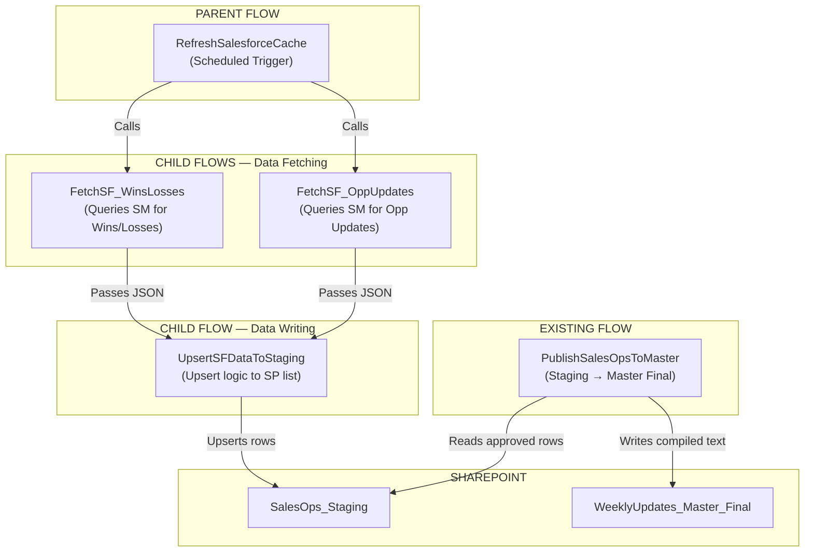

# Flow Specification Document — Salesforce Batch Pipeline

> **Version**: 1.0
> **Last Updated**: 2026-07-20
> **Author**: Luis Alarcon
> **Status**: Draft — Pending field mapping from Power BI Semantic Model

This document describes every flow in the Salesforce → SharePoint batch pipeline as an API specification. Use it as the build reference when constructing each flow in Power Automate.

---

## Flow Inventory



| #   | Flow Name                 | Type     | Layer        | Purpose                                                            |
| :-- | :------------------------ | :------- | :----------- | :----------------------------------------------------------------- |
| 1   | `RefreshSalesforceCache`  | Parent   | Orchestrator | Scheduled trigger; calls both fetch flows, then calls upsert       |
| 2   | `FetchSF_WinsLosses`      | Child    | Data Fetch   | Queries Power BI SM for closed won/lost opportunities              |
| 3   | `FetchSF_OppUpdates`      | Child    | Data Fetch   | Queries Power BI SM for modified open opportunities                |
| 4   | `UpsertSFDataToStaging`   | Child    | Data Write   | Receives a JSON array + section name, upserts to`SalesOps_Staging` |
| 5   | `PublishSalesOpsToMaster` | Existing | Publish      | Compiles approved staging rows into`WeeklyUpdates_Master_Final`    |

---

## Conventions Used in This Doc

```
[YOUR_VALUE]     →  Placeholder you need to fill in from your SM/environment
«DAX»            →  DAX query syntax (for Power BI connector)
«OData»          →  OData filter syntax (for SharePoint connector)
«Expression»     →  Power Automate expression
```

---

---

# Flow 1: `RefreshSalesforceCache`

> **Role**: The top-level orchestrator. Runs on a schedule, calls the two fetch flows, and passes their results to the upsert flow.

## Trigger

| Property            | Value                                                                    |
| :------------------ | :----------------------------------------------------------------------- |
| **Type**      | Recurrence (Scheduled)                                                   |
| **Frequency** | Daily                                                                    |
| **Time**      | `[YOUR_VALUE]` — Set to ~90 min after your Power BI SM refresh starts |
| **Time Zone** | Eastern (or your local)                                                  |
| **Days**      | Every day (Mon–Sun) or weekdays only — your call                       |

## Inputs

None — this is the entry point. All configuration is internal.

## Internal Variables

| Variable             | Type    | Initial Value                  | Purpose                                               |
| :------------------- | :------ | :----------------------------- | :---------------------------------------------------- |
| `varCurrentFriday` | String  | `«Expression»` (see below) | The Friday of the current week, used as`ReportDate` |
| `varRunTimestamp`  | String  | `utcNow()`                   | Timestamp for logging                                 |
| `varSuccess`       | Boolean | `true`                       | Tracks if all child flows succeeded                   |

**`varCurrentFriday` expression:**

```
addDays(utcNow(), sub(5, dayOfWeek(utcNow())), 'yyyy-MM-dd')
```

## Processing Steps

```
STEP 1: Initialize variables
         → varCurrentFriday, varRunTimestamp, varSuccess

STEP 2: Call child flow "FetchSF_WinsLosses"
         → Input:  { ReportDate: varCurrentFriday }
         → Output: { WinsLossesJSON: string }

STEP 3: Call child flow "FetchSF_OppUpdates"
         → Input:  { ReportDate: varCurrentFriday }
         → Output: { OppUpdatesJSON: string }

STEP 4: Call child flow "UpsertSFDataToStaging"
         → Input:  {
               Section: "Wins/Losses",
               DataJSON: WinsLossesJSON,
               ReportDate: varCurrentFriday
           }

STEP 5: Call child flow "UpsertSFDataToStaging"
         → Input:  {
               Section: "Opportunities/Updates",
               DataJSON: OppUpdatesJSON,
               ReportDate: varCurrentFriday
           }

STEP 6: (Optional) Send success/failure notification
         → Email or Teams message to you
```

## Output

None (parent flow — no caller to respond to).

## Error Handling

| Scenario                                  | Action                                                                       |
| :---------------------------------------- | :--------------------------------------------------------------------------- |
| Child flow`FetchSF_WinsLosses` fails    | Set`varSuccess = false`. Log error. Continue to Opp Updates (don't block). |
| Child flow`FetchSF_OppUpdates` fails    | Set`varSuccess = false`. Log error.                                        |
| Child flow`UpsertSFDataToStaging` fails | Set`varSuccess = false`. Log error.                                        |
| All steps complete                        | If`varSuccess = false`, send notification with error details.              |

> [!TIP]
> Use **Configure Run After** on Steps 3–5 so they run regardless of whether the previous step succeeded or failed. This way a failure in Wins doesn't block Opps.

---

---

# Flow 2: `FetchSF_WinsLosses`

> **Role**: Queries the Power BI semantic model for opportunities that closed (won or lost) within the reporting window. Returns a clean JSON array.

## Trigger

| Property       | Value                                |
| :------------- | :----------------------------------- |
| **Type** | Manually trigger a flow (Child Flow) |

## Inputs

| Parameter      | Type   | Required | Description                                                     |
| :------------- | :----- | :------- | :-------------------------------------------------------------- |
| `ReportDate` | String | Yes      | The Friday date (`yyyy-MM-dd`) for the current reporting week |

## Internal Variables

| Variable         | Type   | Purpose                                               |
| :--------------- | :----- | :---------------------------------------------------- |
| `varStartDate` | String | Beginning of the reporting window (previous Saturday) |

**`varStartDate` expression:**

```
addDays(triggerBody()?['ReportDate'], -6, 'yyyy-MM-dd')
```

> This gives you a 7-day window: Saturday through Friday.

## Processing Steps

```
STEP 1: Initialize varStartDate

STEP 2: Run a query against a dataset (Power BI Connector)
         → Workspace:  [YOUR_WORKSPACE_ID]
         → Dataset:    [YOUR_DATASET_ID]
         → Query:      «DAX» (see below)

STEP 3: Parse JSON
         → Schema: (see Output Schema below)

STEP 4: Respond to a Power App or flow
         → Output: WinsLossesJSON = string(body('Parse_JSON'))
```

## DAX Query

```dax
EVALUATE
FILTER(
    SELECTCOLUMNS(
        Opportunities,
        "Region",           Opportunities[YOUR_REGION_FIELD],
        "CustomerName",     Opportunities[YOUR_CUSTOMER_FIELD],
        "UpdateText",       Opportunities[YOUR_DESCRIPTION_FIELD],
        "Amount",           Opportunities[YOUR_AMOUNT_FIELD],
        "Stage",            Opportunities[YOUR_STAGE_FIELD],
        "CloseDate",        Opportunities[YOUR_CLOSE_DATE_FIELD],
        "SF_OpportunityId", Opportunities[YOUR_OPP_ID_FIELD],
        "OwnerName",        Opportunities[YOUR_OWNER_FIELD]
    ),
    AND(
        Opportunities[YOUR_STAGE_FIELD] IN { "Closed Won", "Closed Lost" },
        Opportunities[YOUR_CLOSE_DATE_FIELD] >= DATE([YEAR], [MONTH], [DAY]),
        Opportunities[YOUR_CLOSE_DATE_FIELD] <= DATE([YEAR], [MONTH], [DAY])
    )
)
```

> [!IMPORTANT]
> **You need to fill in:**
>
> - The exact table name (might not be `Opportunities` — check your semantic model)
> - Every `[YOUR_*_FIELD]` with the actual column names from your SM field extraction flow
> - The date filter values (use Power Automate expressions to inject `varStartDate` and `ReportDate` into the DAX string)
>
> **How to inject dates into DAX in Power Automate:**
> Build the query string using a Compose action:
>
> ```
> concat(
>   'EVALUATE FILTER( SELECTCOLUMNS( Opportunities, "Region", Opportunities[Region__c], ... ), AND( Opportunities[CloseDate] >= DATE(',
>   formatDateTime(variables('varStartDate'), 'yyyy'),
>   ',',
>   formatDateTime(variables('varStartDate'), 'MM'),
>   ',',
>   formatDateTime(variables('varStartDate'), 'dd'),
>   '), ... ))'
> )
> ```

## Output

| Parameter          | Type   | Description                    |
| :----------------- | :----- | :----------------------------- |
| `WinsLossesJSON` | String | JSON array of win/loss records |

### Output Record Schema

```json
[
  {
    "Region": "AT&T",
    "CustomerName": "CA North Bay",
    "UpdateText": "3x Large OR UOS nodes",
    "Amount": "130000",
    "Stage": "Closed Won",
    "CloseDate": "2026-07-18",
    "SF_OpportunityId": "006XXXXXXXXXXXXXXX",
    "OwnerName": "Patrick Smith"
  }
]
```

## Error Handling

| Scenario                       | Action                                                              |
| :----------------------------- | :------------------------------------------------------------------ |
| Power BI query fails (401/403) | Return empty array`[]`. Log error message.                        |
| Power BI query returns 0 rows  | Return empty array`[]`. This is valid (no wins/losses this week). |
| Query timeout                  | Return empty array. Parent flow will log the failure.               |

---

---

# Flow 3: `FetchSF_OppUpdates`

> **Role**: Queries the Power BI semantic model for open opportunities that were modified within the reporting window. Returns a clean JSON array.

## Trigger

| Property       | Value                                |
| :------------- | :----------------------------------- |
| **Type** | Manually trigger a flow (Child Flow) |

## Inputs

| Parameter      | Type   | Required | Description                                                     |
| :------------- | :----- | :------- | :-------------------------------------------------------------- |
| `ReportDate` | String | Yes      | The Friday date (`yyyy-MM-dd`) for the current reporting week |

## Internal Variables

| Variable         | Type   | Purpose                                               |
| :--------------- | :----- | :---------------------------------------------------- |
| `varStartDate` | String | Beginning of the reporting window (previous Saturday) |

## Processing Steps

```
STEP 1: Initialize varStartDate
         → Same expression as FetchSF_WinsLosses

STEP 2: Run a query against a dataset (Power BI Connector)
         → Workspace:  [YOUR_WORKSPACE_ID]
         → Dataset:    [YOUR_DATASET_ID]
         → Query:      «DAX» (see below)

STEP 3: Parse JSON

STEP 4: Respond to a Power App or flow
         → Output: OppUpdatesJSON = string(body('Parse_JSON'))
```

## DAX Query

```dax
EVALUATE
FILTER(
    SELECTCOLUMNS(
        Opportunities,
        "Region",           Opportunities[YOUR_REGION_FIELD],
        "CustomerName",     Opportunities[YOUR_CUSTOMER_FIELD],
        "UpdateText",       Opportunities[YOUR_DESCRIPTION_FIELD],
        "Amount",           Opportunities[YOUR_AMOUNT_FIELD],
        "Stage",            Opportunities[YOUR_STAGE_FIELD],
        "LastModifiedDate", Opportunities[YOUR_LAST_MODIFIED_FIELD],
        "SF_OpportunityId", Opportunities[YOUR_OPP_ID_FIELD],
        "OwnerName",        Opportunities[YOUR_OWNER_FIELD],
        "Probability",      Opportunities[YOUR_PROBABILITY_FIELD]
    ),
    AND(
        NOT(Opportunities[YOUR_STAGE_FIELD] IN { "Closed Won", "Closed Lost" }),
        Opportunities[YOUR_LAST_MODIFIED_FIELD] >= DATE([YEAR], [MONTH], [DAY])
    )
)
```

> [!NOTE]
> **Key difference from Wins/Losses**: This query filters for open opportunities (NOT closed) that have been **modified** since the start of the reporting window. The `LastModifiedDate` filter catches stage changes, amount updates, description edits — anything that changed on the record.

## Output

| Parameter          | Type   | Description                                     |
| :----------------- | :----- | :---------------------------------------------- |
| `OppUpdatesJSON` | String | JSON array of modified open opportunity records |

### Output Record Schema

```json
[
  {
    "Region": "AT&T",
    "CustomerName": "Wireline",
    "UpdateText": "VAR removal amendments executed...",
    "Amount": "64000",
    "Stage": "Negotiation",
    "LastModifiedDate": "2026-07-17",
    "SF_OpportunityId": "006XXXXXXXXXXXXXXX",
    "OwnerName": "Patrick Smith",
    "Probability": "75"
  }
]
```

## Error Handling

Same pattern as `FetchSF_WinsLosses`.

---

---

# Flow 4: `UpsertSFDataToStaging`

> **Role**: The shared write layer. Receives a JSON array from either fetch flow and performs an upsert against `SalesOps_Staging`. Handles create, update, and orphan deletion for Salesforce-sourced rows only.

## Trigger

| Property       | Value                                |
| :------------- | :----------------------------------- |
| **Type** | Manually trigger a flow (Child Flow) |

## Inputs

| Parameter      | Type   | Required | Description                                      |
| :------------- | :----- | :------- | :----------------------------------------------- |
| `Section`    | String | Yes      | `"Wins/Losses"` or `"Opportunities/Updates"` |
| `DataJSON`   | String | Yes      | JSON array string of records from the fetch flow |
| `ReportDate` | String | Yes      | The Friday date (`yyyy-MM-dd`)                 |

## Internal Variables

| Variable            | Type    | Initial Value                        | Purpose                                                                 |
| :------------------ | :------ | :----------------------------------- | :---------------------------------------------------------------------- |
| `varIncomingData` | Array   | `json(triggerBody()?['DataJSON'])` | Parsed array of incoming SF records                                     |
| `varIncomingIds`  | Array   | `[]`                               | Collect all SF_OpportunityIds from incoming data (for orphan detection) |
| `varCreatedCount` | Integer | `0`                                | Counter for new rows created                                            |
| `varUpdatedCount` | Integer | `0`                                | Counter for rows updated                                                |
| `varDeletedCount` | Integer | `0`                                | Counter for orphaned rows deleted                                       |

## Processing Steps

```
STEP 1: Initialize variables
         → Parse DataJSON into varIncomingData
         → Initialize counters

STEP 2: Collect incoming IDs
         → Select action on varIncomingData
         → Map: item()?['SF_OpportunityId']
         → Store result in varIncomingIds

STEP 3: Get existing SF rows from SharePoint
         → Action: Get Items (SharePoint)
         → Site:   [YOUR_SP_SITE]
         → List:   SalesOps_Staging
         → Filter: «OData»
            Source eq 'Salesforce'
            and Section eq '[Section input]'
            and ReportDate eq '[ReportDate input]'
         → Store as varExistingRows

STEP 4: UPSERT — Loop through incoming data
         → Apply to each: varIncomingData
         │
         ├── Compose: LookupExisting
         │   → Filter varExistingRows where
         │     SF_OpportunityId = current item's SF_OpportunityId
         │
         ├── Condition: length(LookupExisting) > 0
         │
         │   ── YES (UPDATE existing row) ──
         │   → Update Item (SharePoint)
         │     ID:            first(body('LookupExisting'))?['ID']
         │     Title:         current item Region
         │     CustomerName:  current item CustomerName
         │     UpdateText:    current item UpdateText
         │     Amount:        current item Amount
         │     Stage:         current item Stage
         │     SubmittedOn:   utcNow()
         │   → Increment varUpdatedCount
         │
         │   ── NO (CREATE new row) ──
         │   → Create Item (SharePoint)
         │     Title:              current item Region
         │     Section:            {Value: [Section input]}
         │     CustomerName:       current item CustomerName
         │     UpdateText:         current item UpdateText
         │     Amount:             current item Amount
         │     Stage:              current item Stage
         │     ReportDate:         [ReportDate input]
         │     Source:             {Value: "Salesforce"}
         │     SF_OpportunityId:   current item SF_OpportunityId
         │     SF_Link:            concat('[YOUR_SF_BASE_URL]',
         │                           current item SF_OpportunityId,
         │                           '/view')
         │     Status:             {Value: "Submitted"}
         │     IncludeInReport:    false
         │     SubmittedOn:        utcNow()
         │   → Increment varCreatedCount

STEP 5: DELETE ORPHANS — Loop through existing SF rows
         → Apply to each: varExistingRows
         │
         ├── Condition: current item SF_OpportunityId
         │              NOT IN varIncomingIds
         │
         │   ── YES (orphan — no longer in SF query results) ──
         │   → Delete Item (SharePoint)
         │     ID: current item ID
         │   → Increment varDeletedCount
         │
         │   ── NO ──
         │   → Skip (already handled in Step 4)

STEP 6: Respond to a Power App or flow
         → Output: {
               Status: "Success",
               Created: varCreatedCount,
               Updated: varUpdatedCount,
               Deleted: varDeletedCount
           }
```

> [!WARNING]
> **Step 3 filter is critical.** The OData filter MUST include `Source eq 'Salesforce'`. Without this, the flow would pick up manually-entered rows and potentially delete them in Step 5 as "orphans."

> [!TIP]
> **Performance — "NOT IN" check in Step 5:**
> Power Automate doesn't have a native "IN" operator for arrays. To check if an ID is NOT in the incoming list:
>
> ```
> contains(
>   join(variables('varIncomingIds'), ','),
>   items('Apply_to_each_Existing')?['SF_OpportunityId']
> )
> ```
>
> If `contains()` returns `false`, the row is an orphan.

## Output

| Parameter   | Type    | Description                     |
| :---------- | :------ | :------------------------------ |
| `Status`  | String  | `"Success"` or `"Failed"`   |
| `Created` | Integer | Number of new rows created      |
| `Updated` | Integer | Number of existing rows updated |
| `Deleted` | Integer | Number of orphaned rows removed |

## Error Handling

| Scenario                                        | Action                                                                                                                                    |
| :---------------------------------------------- | :---------------------------------------------------------------------------------------------------------------------------------------- |
| `DataJSON` is empty (`[]`)                  | Skip Steps 4 and 5. Return`Created: 0, Updated: 0, Deleted: 0`. Do NOT delete existing rows (empty result ≠ "everything was removed"). |
| SharePoint Get Items returns 0 existing rows    | All incoming records will be CREATEs. No orphan deletion needed.                                                                          |
| SharePoint Create/Update fails on a single item | Log the error. Continue to next item (don't break the loop). Decrement success at end.                                                    |
| `DataJSON` is malformed                       | Fail fast. Return`Status: "Failed"`. Parent flow will log.                                                                              |

> [!CAUTION]
> **Empty result safety:** If the Power BI query returned 0 results (PBI was down, refresh failed, query error), `DataJSON` will be `[]`. The flow should **NOT** delete all existing SF rows in this case — that would wipe the cache. Check `length(varIncomingData) > 0` before running the orphan deletion loop.

---

---

# Flow 5: `PublishSalesOpsToMaster` (Existing — Updated Spec)

> **Role**: Reads approved rows from `SalesOps_Staging` and compiles them into formatted text for `WeeklyUpdates_Master_Final`. This flow already exists in your V.4 architecture — this spec updates it to handle the new `Source` column.

## Trigger

| Property       | Value                                                     |
| :------------- | :-------------------------------------------------------- |
| **Type** | Manually trigger a flow (called from Power App Admin Hub) |

## Inputs

| Parameter      | Type   | Required | Description                      |
| :------------- | :----- | :------- | :------------------------------- |
| `ReportDate` | String | Yes      | The Friday date (`yyyy-MM-dd`) |

## Processing Steps

```
STEP 1: Get approved rows from SalesOps_Staging
         → Filter: «OData»
            ReportDate eq '[ReportDate]'
            and IncludeInReport eq 1
            and Status/Value eq 'Approved'

         NOTE: This pulls BOTH Source="Salesforce" and Source="Manual"
               rows — the publish flow doesn't care where the data
               came from. If it's approved and marked for report,
               it gets published.

STEP 2: Apply to each approved row
         │
         ├── Compose: FormattedBullet
         │   → concat(
         │       items('Apply_to_each')?['CustomerName'],
         │       ': ',
         │       items('Apply_to_each')?['UpdateText'],
         │       if(
         │         empty(items('Apply_to_each')?['Amount']),
         │         '',
         │         concat(' (', items('Apply_to_each')?['Amount'], ')')
         │       )
         │     )
         │
         ├── Create Item in WeeklyUpdates_Master_Final
         │   → ReportDate:          [ReportDate input]
         │   → TeamName:            {Value: "Sales Ops"}
         │   → Section:             items('Apply_to_each')?['Section']
         │   → Region:              items('Apply_to_each')?['Title']
         │   → FormattedBulletText: outputs('FormattedBullet')
         │   → PublishedOn:         utcNow()
         │   → SourceListItemID:    items('Apply_to_each')?['ID']
         │
         ├── Update original staging row
         │   → Status: {Value: "Published"}

STEP 3: Respond
         → Output: { PublishedCount: [count] }
```

## Error Handling

| Scenario                    | Action                                                                  |
| :-------------------------- | :---------------------------------------------------------------------- |
| No rows match the filter    | Return`PublishedCount: 0`. Not an error — just nothing approved yet. |
| Create item fails in Master | Log the error. Skip that row. Continue.                                 |

---

---

# Appendix A: SharePoint List Reference

## `SalesOps_Staging` — Column Spec

| #  | Column           | Internal Name        | Type               | Choice Values                                                          | Default   |
| :- | :--------------- | :------------------- | :----------------- | :--------------------------------------------------------------------- | :-------- |
| 1  | Title            | `Title`            | Single line        | —                                                                     | —        |
| 2  | Section          | `Section`          | Choice             | `Wins/Losses`, `Opportunities/Updates`                             | —        |
| 3  | CustomerName     | `CustomerName`     | Single line        | —                                                                     | —        |
| 4  | UpdateText       | `UpdateText`       | Multi-line (plain) | —                                                                     | —        |
| 5  | Amount           | `Amount`           | Single line        | —                                                                     | —        |
| 6  | Stage            | `Stage`            | Single line        | —                                                                     | —        |
| 7  | ReportDate       | `ReportDate`       | Date only          | —                                                                     | —        |
| 8  | Source           | `Source`           | Choice             | `Salesforce`, `Manual`                                             | —        |
| 9  | SF_OpportunityId | `SF_OpportunityId` | Single line        | —                                                                     | —        |
| 10 | SF_Link          | `SF_Link`          | Single line (URL)  | —                                                                     | —        |
| 11 | Status           | `Status`           | Choice             | `Draft`, `Submitted`, `Exec Review`, `Approved`, `Published` | `Draft` |
| 12 | IncludeInReport  | `IncludeInReport`  | Yes/No             | —                                                                     | `No`    |
| 13 | SubmittedBy      | `SubmittedBy`      | Person             | —                                                                     | —        |
| 14 | SubmittedOn      | `SubmittedOn`      | Date/Time          | —                                                                     | —        |
| 15 | Notes            | `Notes`            | Multi-line (plain) | —                                                                     | —        |
| 16 | CarriedForward   | `CarriedForward`   | Yes/No             | —                                                                     | `No`    |
| 17 | PriorWeekID      | `PriorWeekID`      | Number             | —                                                                     | —        |

## `UserRegionConfig` — Column Spec

| # | Column    | Type        | Example                                      |
| :- | :-------- | :---------- | :------------------------------------------- |
| 1 | UserEmail | Single line | `patrick@fujitsu.com`                      |
| 2 | Region    | Single line | `AT&T`                                     |
| 3 | TeamName  | Choice      | `Sales Ops`, `Marketing`, `Commercial` |
| 4 | Role      | Choice      | `Stakeholder`, `Executive`, `Admin`    |

## `WeeklyUpdates_Master_Final` — Column Spec

| # | Column              | Type               | Example                                    |
| :- | :------------------ | :----------------- | :----------------------------------------- |
| 1 | ReportDate          | Date               | `2026-07-11`                             |
| 2 | TeamName            | Choice             | `Sales Ops`                              |
| 3 | Section             | Choice             | `Wins/Losses`, `Opportunities/Updates` |
| 4 | Region              | Single line        | `Canada`                                 |
| 5 | FormattedBulletText | Multi-line (plain) | `Bell: RF Eng SME invited... ($3.88M)`   |
| 6 | PublishedOn         | Date/Time          | `2026-07-11 3:00 PM`                     |
| 7 | SourceListItemID    | Number             | `42`                                     |

---

# Appendix B: Flow Dependency Map

```
RefreshSalesforceCache (Parent - Scheduled)
│
├── FetchSF_WinsLosses (Child)
│   └── Power BI Connector: Run a query against a dataset
│
├── FetchSF_OppUpdates (Child)
│   └── Power BI Connector: Run a query against a dataset
│
├── UpsertSFDataToStaging (Child - called twice)
│   ├── SharePoint: Get Items (read existing SF rows)
│   ├── SharePoint: Create Item (new records)
│   ├── SharePoint: Update Item (changed records)
│   └── SharePoint: Delete Item (orphaned records)
│
└── (Does NOT call PublishSalesOpsToMaster
     — that's triggered from the Power App)


PublishSalesOpsToMaster (Separate - App-triggered)
│
├── SharePoint: Get Items from SalesOps_Staging
├── SharePoint: Create Item in WeeklyUpdates_Master_Final
└── SharePoint: Update Item in SalesOps_Staging (mark Published)
```

---

# Appendix C: Connector & License Requirements

| Connector            | Actions Used In                                        | License            |
| :------------------- | :----------------------------------------------------- | :----------------- |
| **Power BI**   | `FetchSF_WinsLosses`, `FetchSF_OppUpdates`         | Premium (per user) |
| **SharePoint** | `UpsertSFDataToStaging`, `PublishSalesOpsToMaster` | Standard           |
| **Recurrence** | `RefreshSalesforceCache`                             | Standard           |

> [!NOTE]
> The Power BI connector's **"Run a query against a dataset"** action requires Power Automate Premium. You already have this license for the Word Document connector flows.

---

# Appendix D: Placeholder Reference

Every `[YOUR_VALUE]` placeholder in this document that you need to fill in:

| Placeholder                    | Where Used                    | How to Find It                                                       |
| :----------------------------- | :---------------------------- | :------------------------------------------------------------------- |
| `[YOUR_WORKSPACE_ID]`        | Fetch flows — PBI connector  | Power BI Service → Workspace → URL contains the ID                 |
| `[YOUR_DATASET_ID]`          | Fetch flows — PBI connector  | Power BI Service → Dataset → Settings → URL contains the ID       |
| `[YOUR_REGION_FIELD]`        | DAX queries                   | Your SM field extraction flow output                                 |
| `[YOUR_CUSTOMER_FIELD]`      | DAX queries                   | Your SM field extraction flow output                                 |
| `[YOUR_DESCRIPTION_FIELD]`   | DAX queries                   | Your SM field extraction flow output                                 |
| `[YOUR_AMOUNT_FIELD]`        | DAX queries                   | Your SM field extraction flow output                                 |
| `[YOUR_STAGE_FIELD]`         | DAX queries                   | Your SM field extraction flow output                                 |
| `[YOUR_CLOSE_DATE_FIELD]`    | DAX query (Wins/Losses)       | Your SM field extraction flow output                                 |
| `[YOUR_LAST_MODIFIED_FIELD]` | DAX query (Opp Updates)       | Your SM field extraction flow output                                 |
| `[YOUR_OPP_ID_FIELD]`        | DAX queries                   | Your SM field extraction flow output                                 |
| `[YOUR_OWNER_FIELD]`         | DAX queries                   | Your SM field extraction flow output                                 |
| `[YOUR_PROBABILITY_FIELD]`   | DAX query (Opp Updates)       | Your SM field extraction flow output                                 |
| `[YOUR_SP_SITE]`             | Upsert flow — SP connector   | Your SharePoint site URL                                             |
| `[YOUR_SF_BASE_URL]`         | Upsert flow — SF_Link column | e.g.`https://fujitsu.lightning.force.com/lightning/r/Opportunity/` |
