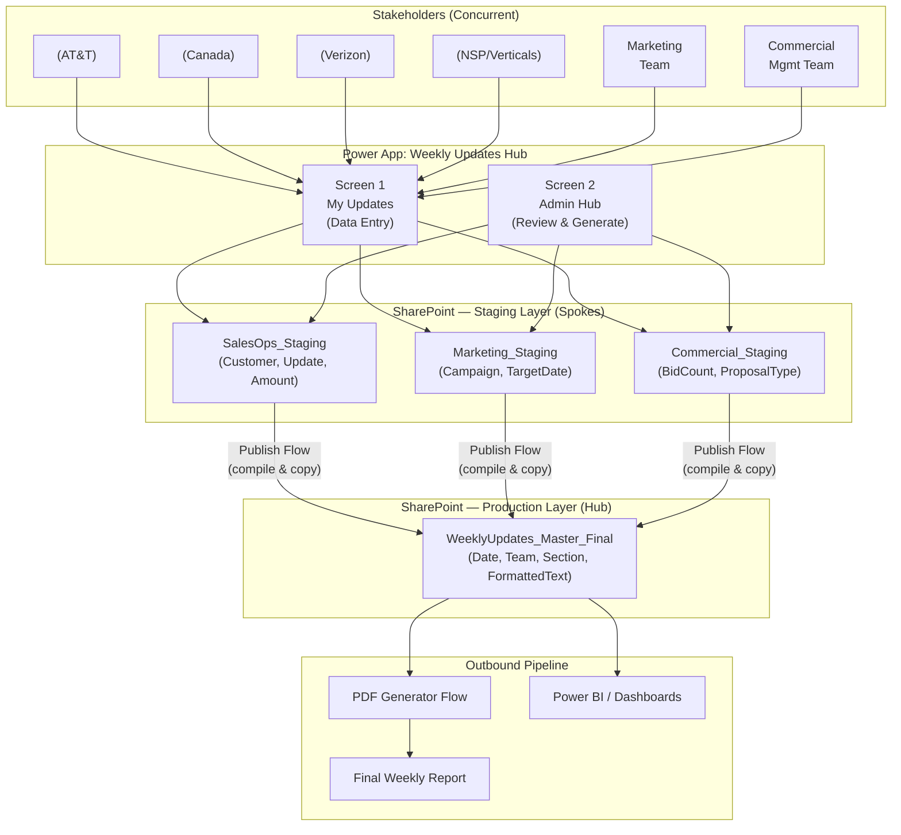

# MVP Build Plan: Weekly Updates Power App

This document lays out the full MVP — the **Federated Staging & Consolidated Master** data architecture, two core Power App screens, the SharePoint schema for each layer, and the **user-value features** that make this app worth adopting for stakeholders (not just management).

---

## The Big Picture



> [!IMPORTANT]
> **Key Architecture: Federated Staging & Consolidated Master**
>
> - Each team gets their own **Staging List** (spoke) with columns tailored to their specific data needs.
> - A shared **Master Final List** (hub) stores only the compiled, approved bullet-point text strings.
> - A **Publish Flow** transforms each team's structured data into standardized text and copies it to the Master.
> - The PDF generator and dashboards **only read from the Master** — they are completely insulated from draft edits.

---

## Part 1: SharePoint List Architecture

### When to Create a New Staging List

| Scenario                                                        | Action                                                         | Why                                                                                                |
| :-------------------------------------------------------------- | :------------------------------------------------------------- | :------------------------------------------------------------------------------------------------- |
| A new team joins the weekly report                              | Create a**new Staging List** for them                    | Each team has unique columns. Mixing them in one list creates clutter and empty fields.            |
| A team has different data fields than others                    | Create a**new Staging List**                             | E.g., Marketing needs`CampaignName` and `TargetDate`, which Sales Ops doesn't use.             |
| Different user groups need different edit permissions           | Create a**new Staging List**                             | SharePoint permissions are easiest to manage at the list level.                                    |
| A completely different department wants their own weekly report | Duplicate the**Master List**                             | E.g.,`HR_WeeklyUpdates_Master_Final`. Clone the outbound flows and point them at the new master. |
| You want a new section within the same team's report            | Add a**Choice value** to the existing `Section` column | E.g., adding`Pipeline Updates` alongside `Wins/Losses` in the Sales Ops staging list.          |

---

### List 1: `SalesOps_Staging` (Spoke — Sales Team)

| Column Name        | Type                  | Purpose                              | Example Values                                                         |
| :----------------- | :-------------------- | :----------------------------------- | :--------------------------------------------------------------------- |
| `Title`          | Single line (default) | Region name                          | `Canada`, `Verizon`, `AT&T`                                      |
| `Section`        | Choice                | Which report section                 | `Wins/Losses`, `Opportunities/Updates`                             |
| `CustomerName`   | Single line           | Customer or sub-account              | `Bell and TELUS`, `VZM OPW`                                        |
| `UpdateText`     | Multi-line (plain)    | The update narrative                 | `RF Eng SME invited to study...`                                     |
| `Amount`         | Single line           | Dollar amount                        | `$3.88M`, `$130K`                                                  |
| `ReportDate`     | Date                  | The Friday this update belongs to    | `2026-07-11`                                                         |
| `Status`         | Choice                | Workflow state                       | `Draft`, `Submitted`, `Exec Review`, `Approved`, `Published` |
| `SubmittedBy`    | Person                | Auto-populated with logged-in user   | `Patrick Smith`                                                      |
| `SubmittedOn`    | Date/Time             | Timestamp of submission              | `2026-07-10 2:15 PM`                                                 |
| `Notes`          | Multi-line (plain)    | Private notes (never in report)      | `Follow up with Jim on pricing`                                      |
| `CarriedForward` | Yes/No                | Flag for recurring/ongoing deals     | `Yes`                                                                |
| `PriorWeekID`    | Number                | Links to the previous week's version | `42`                                                                 |

---

### List 2: `Marketing_Staging` (Spoke — Marketing Team)

| Column Name      | Type               | Purpose                           | Example Values                                        |
| :--------------- | :----------------- | :-------------------------------- | :---------------------------------------------------- |
| `Title`        | Single line        | Highlight category                | `Campaign`, `Event`, `Industry Trend`           |
| `CampaignName` | Single line        | Name of campaign or event         | `Q3 Data Center Fiber Launch`                       |
| `UpdateText`   | Multi-line (plain) | Description of the highlight      | `Completed planning for regional...`                |
| `TargetDate`   | Date               | Campaign target or event date     | `2026-08-15`                                        |
| `ReportDate`   | Date               | The Friday this update belongs to | `2026-07-11`                                        |
| `Status`       | Choice             | Workflow state                    | `Draft`, `Submitted`, `Approved`, `Published` |
| `SubmittedBy`  | Person             | Auto-populated                    | `Rich Marketing`                                    |

---

### List 3: `Commercial_Staging` (Spoke — Commercial Mgmt Team)

| Column Name      | Type               | Purpose                                 | Example Values                                        |
| :--------------- | :----------------- | :-------------------------------------- | :---------------------------------------------------- |
| `Title`        | Single line        | Category                                | `Bid`, `Proposal`, `Contract Renewal`           |
| `ProposalName` | Single line        | Name of proposal/bid                    | `Regional Transit RFP`                              |
| `UpdateText`   | Multi-line (plain) | Status description                      | `RFP submitted, awaiting response`                  |
| `BidAmount`    | Single line        | Dollar value                            | `$8.5M`                                             |
| `BidCount`     | Number             | Number of active bids (for PDG section) | `12`                                                |
| `ReportDate`   | Date               | The Friday this update belongs to       | `2026-07-11`                                        |
| `Status`       | Choice             | Workflow state                          | `Draft`, `Submitted`, `Approved`, `Published` |
| `SubmittedBy`  | Person             | Auto-populated                          | `Rainey Team`                                       |

---

### List 4: `WeeklyUpdates_Master_Final` (Hub — Production / Read-Only)

This is the **single source of truth** for the PDF generator and Power BI dashboards.

| Column Name             | Type               | Purpose                                      | Example Values                                                             |
| :---------------------- | :----------------- | :------------------------------------------- | :------------------------------------------------------------------------- |
| `ReportDate`          | Date               | The Friday for this report                   | `2026-07-11`                                                             |
| `TeamName`            | Choice             | Which team produced this update              | `Sales Ops`, `Marketing`, `Commercial`                               |
| `Section`             | Choice             | Report section heading                       | `Wins/Losses`, `Opportunities`, `Marketing Highlights`, `PDG Bids` |
| `Region`              | Single line        | Region (if applicable, blank for Marketing)  | `Canada`, `AT&T`                                                       |
| `FormattedBulletText` | Multi-line (plain) | The pre-compiled, ready-to-print bullet      | `Bell and TELUS: RF Eng SME invited to study... ($3.88M)`                |
| `PublishedOn`         | Date/Time          | Timestamp of when this was published         | `2026-07-11 3:00 PM`                                                     |
| `SourceListItemID`    | Number             | ID of the original staging row (audit trail) | `42`                                                                     |

> [!TIP]
> **Permissions**: Set `WeeklyUpdates_Master_Final` to **Read-Only** for all regular users. Only the Power Automate service account (or app-level connection) should have Write access. This prevents anyone from accidentally editing production data.

---

### List 5: `UserRegionConfig` (System Config — Shared)

This small config list controls which users see which regions, and who has admin access.

| Column Name   | Type        | Example Values                            |
| :------------ | :---------- | :---------------------------------------- |
| `UserEmail` | Single line | `patrick@fujitsu.com`                   |
| `Region`    | Single line | `AT&T`                                  |
| `TeamName`  | Choice      | `Sales Ops`                             |
| `Role`      | Choice      | `Stakeholder`, `Executive`, `Admin` |

---

## Part 2: The Publish Flow (Staging → Master)

When an Admin clicks **"Publish to Final"** in the Admin Hub, a Power Automate flow runs for each staging list:

### Sales Ops Publish Logic

For each row in `SalesOps_Staging` where `Status = 'Approved'` and `ReportDate = currentFriday`:

1. **Compile** the structured fields into a formatted string:

   ```
   concat(CustomerName, ': ', UpdateText, ' (', Amount, ')')
   ```

   → Example output: `Bell and TELUS: RF Eng SME invited to study wireless networks. ($3.88M)`
2. **Create item** in `WeeklyUpdates_Master_Final`:

   - `TeamName`: `Sales Ops`
   - `Section`: (copied from staging row)
   - `Region`: (copied from staging `Title`)
   - `FormattedBulletText`: (the compiled string)
   - `SourceListItemID`: (the staging row ID)
3. **Update** the staging row's `Status` to `Published`.

### Marketing Publish Logic

Same pattern, different compile formula:

```
concat(CampaignName, ': ', UpdateText, ' (Target: ', formatDateTime(TargetDate, 'MM/dd'), ')')
```

### Commercial Publish Logic

Same pattern, different compile formula:

```
concat(ProposalName, ': ', UpdateText, ' (', BidAmount, ')')
```

> [!IMPORTANT]
> **Why this is expandable**: When a new team joins, you create their staging list and write **one new Publish Flow** with their specific compile formula. You never touch the PDF generator, the Master list schema, or any other team's flows.

---

## Part 3: Screen 1 — "My Updates" (Data Entry)

This is the screen every stakeholder uses. It dynamically connects to the correct staging list based on the logged-in user's team.

### Layout & Components

```
┌─────────────────────────────────────────────────────────────┐
│  Weekly Updates                          Week: July 11, 2026│
│  ┌─────────────────────────────────────────────────────────┐│
│  │ View: [● My Updates ○ My Team ○ All]                   ││
│  │ [Section ▼ Wins/Losses]   [Region ▼ Canada]            ││
│  └─────────────────────────────────────────────────────────┘│
│                                                             │
│  ┌───────────┬───────────────────────────┬────────┬───────┐│
│  │ Customer  │ Update                    │ Amount │  ⚙️   ││
│  ├───────────┼───────────────────────────┼────────┼───────┤│
│  │ Bell & T  │ RF Eng SME invited to...  │ $3.88M │ ✏️ 🗑️ ││
│  │ VZM OPW   │ Booked the vGNE Software  │ $390K  │ ✏️ 🗑️ ││
│  │           │                           │        │ [+Add]││
│  └───────────┴───────────────────────────┴────────┴───────┘│
│                                                             │
│  ┌──────────────────────────────────────────────────────────┐│
│  │ 📋 My History (Collapsed by default)                    ││
│  │   June 27: Bell & TELUS - $2.1M (Carried Forward ✅)    ││
│  │   June 20: Rogers Core - $1.5M                          ││
│  └──────────────────────────────────────────────────────────┘│
│                                                             │
│  [ 💾 Save All as Draft ]          [ ✅ Submit for Review ] │
└─────────────────────────────────────────────────────────────┘
```

### How to Build It

#### Step 1: Create the App

1. Go to [make.powerapps.com](https://make.powerapps.com).
2. **+ Create** → **Blank canvas app** → Name: `Weekly Updates Hub` → Format: **Tablet**.
3. Add data sources: **SharePoint** → your site → `SalesOps_Staging`, `Marketing_Staging`, `Commercial_Staging`, `UserRegionConfig`.

#### Step 2: Set Up Global Variables (App.OnStart)

```
Set(varCurrentFriday,
    DateAdd(Today(), 5 - Weekday(Today(), StartOfWeek.Monday), TimeUnit.Days)
);
Set(varCurrentUser, User());
Set(varMyRegions,
    Filter(UserRegionConfig, UserEmail = varCurrentUser.Email).Region
);
Set(varMyTeam,
    LookUp(UserRegionConfig, UserEmail = varCurrentUser.Email).TeamName
);
Set(varMyRole,
    LookUp(UserRegionConfig, UserEmail = varCurrentUser.Email).Role
);
Set(varViewMode, "MyUpdates");
```

#### Step 3: Build the View Mode Toggle & Filter Bar

1. Insert a **segmented toggle** or 3 buttons for view mode:
   - `My Updates` → `Set(varViewMode, "MyUpdates")`
   - `My Team` → `Set(varViewMode, "MyTeam")`
   - `All` → `Set(varViewMode, "All")`
2. Insert **Dropdown** controls for `drpSection` and `drpRegion` (same as before).

#### Step 4: Build the Editable Gallery with Dynamic Filter

1. Insert → **Blank vertical gallery** → Name: `galUpdates`.
2. **Items** property (connects to the Sales Ops staging list — adapt for other teams):

```
Sort(
    Filter(
        SalesOps_Staging,
        Title = drpRegion.Selected.Value,
        Section.Value = drpSection.Selected.Value,
        ReportDate = varCurrentFriday,
        Switch(
            varViewMode,
            "MyUpdates", SubmittedBy.Email = varCurrentUser.Email,
            "MyTeam", Title in varMyRegions,
            "All", true
        )
    ),
    ID, SortOrder.Descending
)
```

3. Inside the gallery template, add:
   - **Text Input** → `txtCustomer` → Default: `ThisItem.CustomerName`
   - **Text Input** → `txtUpdate` → Default: `ThisItem.UpdateText`
   - **Text Input** → `txtAmount` → Default: `ThisItem.Amount`
   - **Icon (Edit)** → OnSelect: `EditForm(frmEdit); Navigate(scrEditDetail)`
   - **Icon (Trash)** → OnSelect: `Remove(SalesOps_Staging, ThisItem)`
   - **Edit permissions**: `DisplayMode: If(ThisItem.SubmittedBy.Email = varCurrentUser.Email, DisplayMode.Edit, DisplayMode.View)`

#### Step 5: Build the "+ Add" Button

```Java
OnSelect:
    Patch(
        SalesOps_Staging,
        Defaults(SalesOps_Staging),
        {
            Title: drpRegion.Selected.Value,
            Section: {Value: drpSection.Selected.Value},
            ReportDate: varCurrentFriday,
            Status: {Value: "Draft"},
            SubmittedBy: varCurrentUser,
            SubmittedOn: Now()
        }
    )
```

#### Step 6: Build the "Submit for Review" Button

```
OnSelect:
    ForAll(
        Filter(
            SalesOps_Staging,
            ReportDate = varCurrentFriday,
            SubmittedBy.Email = varCurrentUser.Email,
            Status.Value = "Draft"
        ),
        Patch(
            SalesOps_Staging,
            ThisRecord,
            {Status: {Value: "Submitted"}}
        )
    );
    Notify("Updates submitted for review!", NotificationType.Success)
```

#### Step 7: Build the "My History" Section (User-Value Feature)

Insert a **second gallery** below the main one → Name: `galHistory`.

**Items** property:

```
Filter(
    SalesOps_Staging,
    SubmittedBy.Email = varCurrentUser.Email,
    ReportDate < varCurrentFriday
)
```

Add a **"Carry Forward" button** inside each history row:

```
OnSelect:
    Patch(
        SalesOps_Staging,
        Defaults(SalesOps_Staging),
        {
            Title: ThisItem.Title,
            Section: ThisItem.Section,
            CustomerName: ThisItem.CustomerName,
            UpdateText: "",
            Amount: ThisItem.Amount,
            ReportDate: varCurrentFriday,
            Status: {Value: "Draft"},
            SubmittedBy: varCurrentUser,
            SubmittedOn: Now(),
            CarriedForward: true,
            PriorWeekID: ThisItem.ID
        }
    );
    Notify("Carried forward! Update the text for this week.", NotificationType.Information)
```

> This copies the customer name and amount from a previous week's update into a new draft for this week, but leaves the update text blank so the user writes fresh context.

---

## Part 4: Screen 2 — "Admin Hub" (Review, Approve & Publish)

This is the screen for Sales Ops admins (Danielle, George, Christian). It shows **all** updates across all regions and all staging lists for the current week.

### Layout & Components

```
┌─────────────────────────────────────────────────────────────┐
│  Admin Hub                               Week: July 11, 2026│
│                                                             │
│  ┌─────────────────────────────────────────────────────────┐│
│  │ Submission Status by Team                               ││
│  │ Sales Ops: ✅ 7 items   Marketing: ✅ 3   Commercial: ⬜││
│  └─────────────────────────────────────────────────────────┘│
│  ┌─────────────────────────────────────────────────────────┐│
│  │ Sales Ops Regions                                       ││
│  │ AT&T: ✅ 3   Canada: ✅ 2   Verizon: ⬜   NSP: ✅ 2    ││
│  └─────────────────────────────────────────────────────────┘│
│                                                             │
│  Filter: [All Teams ▼] [All Regions ▼] [All Status ▼]      │
│                                                             │
│  ┌──────┬──────────┬───────────┬────────────────┬─────┬────┐│
│  │ Team │ Region   │ Customer  │ Update         │ $   │ St ││
│  ├──────┼──────────┼───────────┼────────────────┼─────┼────┤│
│  │ Sales│ Canada   │ Bell & T  │ RF Eng SME...  │$3.8M│ ✅ ││
│  │ Sales│ AT&T     │ VZM OPW   │ Booked vGNE... │$390K│ 📝 ││
│  │ Mktg │          │           │ Q3 Campaign... │     │ ✅ ││
│  └──────┴──────────┴───────────┴────────────────┴─────┴────┘│
│                                                             │
│  [ ✅ Approve All Submitted ]    [ 🚀 Publish to Final ]   │
│  [ 📄 Generate Report ]                                     │
└─────────────────────────────────────────────────────────────┘
```

### How to Build It

#### Step 1: Build the Status Dashboard

For each team, insert a **Label**:

```
With(
    {
        count: CountRows(
            Filter(SalesOps_Staging,
                ReportDate = varCurrentFriday,
                Status.Value in ["Submitted", "Approved"]
            )
        )
    },
    If(count > 0,
        "✅ " & count & " items",
        "⬜ 0"
    )
)
```

Repeat for `Marketing_Staging` and `Commercial_Staging`.

#### Step 2: Build the Master Gallery

Use a **Collection** to merge data from all staging lists into one view:

In `App.OnStart` or on screen `OnVisible`:

```
ClearCollect(colAllUpdates,
    AddColumns(
        Filter(SalesOps_Staging, ReportDate = varCurrentFriday),
        "TeamName", "Sales Ops",
        "SourceList", "SalesOps_Staging"
    ),
    AddColumns(
        Filter(Marketing_Staging, ReportDate = varCurrentFriday),
        "TeamName", "Marketing",
        "SourceList", "Marketing_Staging"
    ),
    AddColumns(
        Filter(Commercial_Staging, ReportDate = varCurrentFriday),
        "TeamName", "Commercial",
        "SourceList", "Commercial_Staging"
    )
)
```

Gallery **Items** property:

```
Sort(
    Filter(
        colAllUpdates,
        (drpTeamFilter.Selected.Value = "All" Or TeamName = drpTeamFilter.Selected.Value),
        (drpStatusFilter.Selected.Value = "All" Or Status.Value = drpStatusFilter.Selected.Value)
    ),
    TeamName, SortOrder.Ascending
)
```

#### Step 3: Build the "Approve All" Button

```
OnSelect:
    ForAll(
        Filter(SalesOps_Staging, ReportDate = varCurrentFriday, Status.Value = "Submitted"),
        Patch(SalesOps_Staging, ThisRecord, {Status: {Value: "Approved"}})
    );
    ForAll(
        Filter(Marketing_Staging, ReportDate = varCurrentFriday, Status.Value = "Submitted"),
        Patch(Marketing_Staging, ThisRecord, {Status: {Value: "Approved"}})
    );
    ForAll(
        Filter(Commercial_Staging, ReportDate = varCurrentFriday, Status.Value = "Submitted"),
        Patch(Commercial_Staging, ThisRecord, {Status: {Value: "Approved"}})
    );
    Notify("All submitted updates approved!", NotificationType.Success)
```

#### Step 4: Build the "Publish to Final" Button

This triggers the Power Automate Publish Flow:

```
OnSelect:
    Set(varPublishing, true);
    'PublishSalesOpsToMaster'.Run({ReportDate: Text(varCurrentFriday, "yyyy-MM-dd")});
    'PublishMarketingToMaster'.Run({ReportDate: Text(varCurrentFriday, "yyyy-MM-dd")});
    'PublishCommercialToMaster'.Run({ReportDate: Text(varCurrentFriday, "yyyy-MM-dd")});
    Set(varPublishing, false);
    Notify("All approved updates published to Master!", NotificationType.Success)
```

#### Step 5: Build the "Generate Report" Button

```
OnSelect:
    Set(varGenerating, true);
    'CreateWeeklyReport'.Run({ReportDate: Text(varCurrentFriday, "yyyy-MM-dd")});
    Set(varGenerating, false);
    Notify("Report generated! Check SharePoint.", NotificationType.Success)
```

> The PDF generator flow **only reads from `WeeklyUpdates_Master_Final`**. It never touches any staging list.

---

## Part 5: User-Value Features Summary

These are the features that make individual stakeholders **want** to use the app, not just feel obligated to:

| Feature                         | What It Does                                                                        | Who Benefits                  |
| :------------------------------ | :---------------------------------------------------------------------------------- | :---------------------------- |
| **My History**            | See all your past updates across weeks in one place                                 | Individual users              |
| **Carry Forward**         | One-click to bring a recurring deal into this week's report                         | Individual users              |
| **Private Notes**         | Add personal notes to any update (never shown in report)                            | Individual users              |
| **Deal Thread**           | `PriorWeekID` links let you trace a deal's history week-over-week                 | Individual users + Management |
| **Draft → Submit**       | Work on updates throughout the week without them leaking into the report            | Everyone                      |
| **View Modes**            | Toggle between My Updates / My Team / All without switching apps                    | Everyone                      |
| **Status Dashboard**      | See at a glance who has submitted and who hasn't                                    | Management / Admin            |
| **Inline Editing**        | Admin can fix typos, formatting, and amounts before publishing                      | Admin team                    |
| **Staging → Production** | Approved data is copied to a read-only Master list, protecting historical integrity | System / Audit                |

---

## Part 6: Expansion Playbook

When a new team or process needs to join the system, follow this checklist:

| Step | Action                                                                                 | Estimated Effort |
| :--- | :------------------------------------------------------------------------------------- | :--------------- |
| 1    | Create a new`[TeamName]_Staging` SharePoint list with their custom columns           | 15 min           |
| 2    | Add the team's users to`UserRegionConfig` with `TeamName` and `Role`             | 5 min            |
| 3    | Build a new Power App screen (or clone Screen 1) tailored to their columns             | 1–2 hours       |
| 4    | Create a`Publish[TeamName]ToMaster` Power Automate flow with their compile formula   | 30 min           |
| 5    | Add a`[TeamName]` choice value to the `WeeklyUpdates_Master_Final.TeamName` column | 2 min            |
| 6    | Update the Admin Hub`colAllUpdates` collection to include the new staging list       | 10 min           |

> [!TIP]
> **You never modify**: the Master list schema, the PDF generator flow, or any other team's staging list or publish flow. Each team is a self-contained spoke.

---

## Part 7: Phased Rollout

| Phase             | Scope                                                                                                 | Estimated Effort |
| :---------------- | :---------------------------------------------------------------------------------------------------- | :--------------- |
| **Phase 1** | Create`SalesOps_Staging`, `WeeklyUpdates_Master_Final`, and `UserRegionConfig` SharePoint lists | 45 min           |
| **Phase 2** | Build Screen 1 (My Updates) — gallery, view modes, add row, submit button                            | 2–3 hours       |
| **Phase 3** | Build Screen 2 (Admin Hub) — merged gallery, approve, publish button                                 | 2–3 hours       |
| **Phase 4** | Add user-value features (History gallery, Carry Forward, Notes)                                       | 1–2 hours       |
| **Phase 5** | Build the`PublishSalesOpsToMaster` Power Automate flow                                              | 1 hour           |
| **Phase 6** | Update outbound PDF flow to read from`WeeklyUpdates_Master_Final`                                   | 30 min           |
| **Phase 7** | Embed in SharePoint page or Teams tab, test with 2–3 users                                           | 1 hour           |
| **Phase 8** | Create`Marketing_Staging` and `Commercial_Staging` lists + publish flows                          | 2 hours          |

**Total estimated effort: ~11–14 hours** (spread across sessions)

---

## Open Questions

> [!IMPORTANT]
> **1. Region-to-User Mapping**: Can you confirm which stakeholders own which regions? From the staff meeting notes, it looks like:
>
> - Patrick → AT&T
> - Danielle → Canada
> - Jacob → Verizon
> - George → NSP / Verticals / Regional
>
> Should users only see their own regions, or should everyone see all regions but only edit their own?

> [!IMPORTANT]
> **2. Review Pipeline Stages**: You mentioned the review chain is: Stakeholder → Executive → Sales Ops → Director. Should we add `Exec Review` and `Director Review` as additional `Status` values, or is `Draft → Submitted → Approved → Published` enough for the MVP?

> [!IMPORTANT]
> **3. Marketing & Commercial Teams**: Do you have enough visibility into what columns Marketing (Rich's team) and Commercial (Rainey's team) need in their staging lists? Or should we build Sales Ops first and handle those teams in a later phase?

> [!IMPORTANT]
> **4. Embedding Location**: Do you want the app embedded in a **SharePoint page** (accessible via browser), inside **Microsoft Teams** (as a tab), or both?
