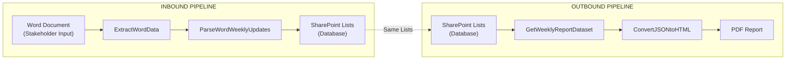
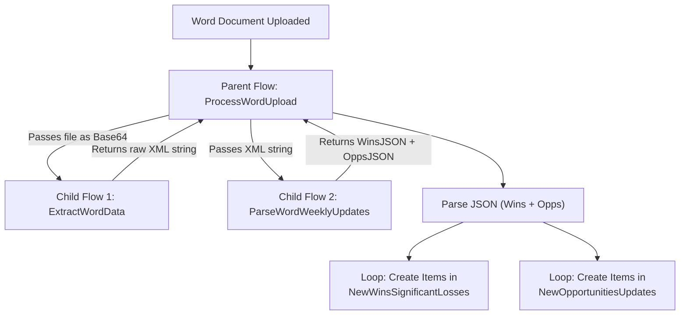
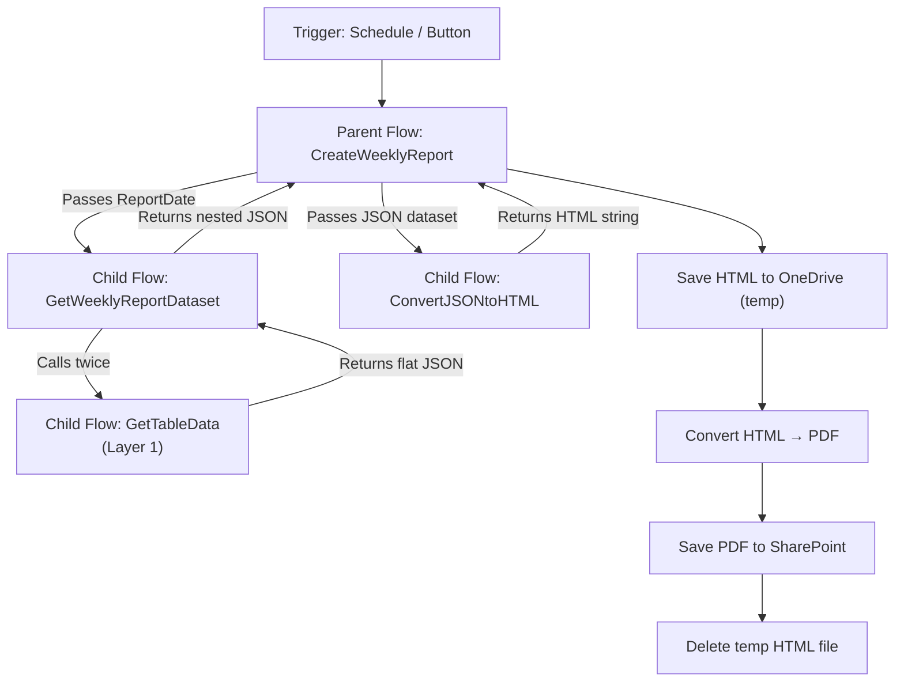
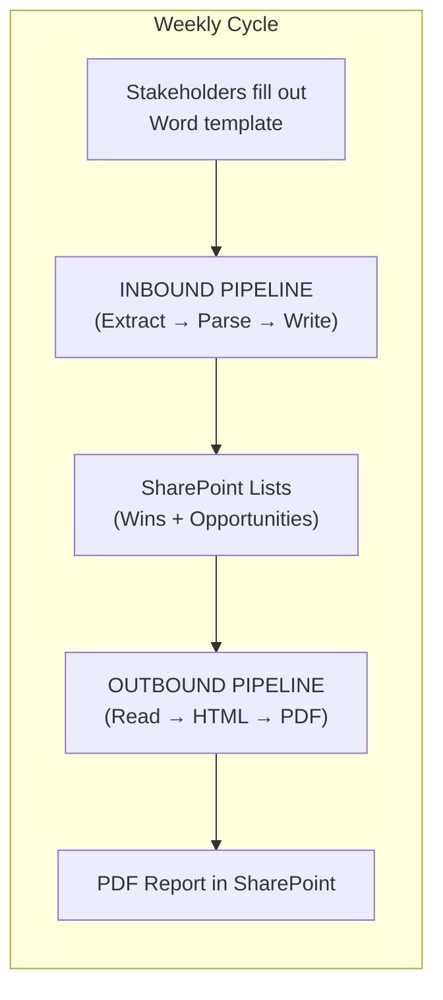

# Weekly Report Automation: System Architecture Overview

This document describes the complete architecture of the Weekly Report Automation system. It covers the two major components, the flows that power them, and how data moves through the system end-to-end.

---

## System at a Glance

The automation system has **two major pipelines** that work together to form a complete data lifecycle:

| Pipeline | Purpose | Direction |
| :--- | :--- | :--- |
| **Inbound** | Gets weekly updates **into** the SharePoint lists | Word Document → SharePoint |
| **Outbound** | Generates a formatted PDF report **from** the SharePoint lists | SharePoint → PDF |

---
## System Break Down 
This section explains 2 separate processes that make this system up. What it does, how it does it, and why its needed. 
## 1. Inbound (Word Document → SharePoint List)

### What It Does
Stakeholders fill out a standardized Word document template containing their weekly updates (organized by region, with bullet points for each customer update). When the completed document is processed, the system extracts the structured data and creates individual items in the SharePoint lists — Giving static, Business intelligence  documents, dynamic computable capabilities.

### How It Works (Non-Premium)
Access to the right tools have not been granted(Word Online) , so an alternative solution will take its place for the mean time: 
A `.docx` file is actually a ZIP archive containing XML files. The system copies the Word file, renames it to `.zip`, extracts it, and reads the raw XML to pull out the data using XPath expressions.

### The Flows
The individual functions and their logic. 
#### Flow 1: `ExtractWordData` (The XML Extractor)
*   **Role**: A generic utility flow that takes any Word document and returns its raw XML content.
*   **Input**: File content (as a Base64 text string) and a file name.
*   **What it does**:
    1. **Receives** the Word file content as Base64 text from a parent flow.
    2. Converts the Base64 back to binary and saves it as a `.zip` file in a temporary OneDrive folder.
    3. Extracts the ZIP archive using OneDrive's **Extract archive to folder** action.
    4. Uses a **Filter array** action to dynamically find the exact path to `word/document.xml` from the extraction output (avoiding hardcoded paths and timing issues).
    5. Reads the XML file using **Get file content using path**.
    6. Cleans up all temporary files and folders from OneDrive.
*   **Output**: The raw XML content of the Word document as a text string (`XMLContent`).

---

#### Flow 2: `ParseWordWeeklyUpdates` (The Data Parser)
*   **Role**: A project-specific flow that takes raw Word XML and extracts structured sales update data using XPath queries.
*   **Input**: Raw XML string from `ExtractWordData`.
*   **What it does**:
    1. Converts the incoming XML string into an XML object using `xml()`.
    2. Runs an XPath query to find all **Region** blocks (outer repeating sections tagged `RegionSection` or `WinsRegionSection` / `OppsRegionSection`).
    3. **Outer Loop (Regions)**: Iterates through each region block, extracting the `RegionTitle` (e.g., "AT&T", "Canada", "Europe").
    4. For each region, runs another XPath query to find all **Bullet** items (inner repeating sections tagged `BulletSection`).
    5. **Inner Loop (Bullets)**: Iterates through each bullet, extracting `CustomerName`, `UpdateText`, and `Amount`.
    6. Filters out placeholder entries (e.g., `[Customer Name]`) using a Condition action.
    7. Appends valid entries to array variables, associating each bullet with its parent region.
*   **Output**: Two JSON arrays as text strings — `WinsJSON` and `OppsJSON` — each containing objects with `Region`, `CustomerName`, `UpdateText`, and `Amount`.

---

#### Parent Flow: `ProcessWordUpload` (The Orchestrator)
*   **Role**: Ties the two child flows together and writes the extracted data to SharePoint.
*   **What it does**:
    1. Receives or retrieves the uploaded Word file.
    2. Calculates the `ReportDate` (the Friday of the current week) using the expression: `addDays(utcNow(), sub(5, dayOfWeek(utcNow())), 'yyyy-MM-dd')`.
    3. Calls `ExtractWordData`, passing the file content as Base64.
    4. Calls `ParseWordWeeklyUpdates`, passing the XML string output from the first child flow.
    5. Parses the returned `WinsJSON` and `OppsJSON` strings using **Parse JSON** actions.
    6. Loops through the Wins array and creates items in the `NewWinsSignificantLosses` SharePoint list.
    7. Loops through the Opportunities array and creates items in the `NewOpportunitiesUpdates` SharePoint list.

---

### Inbound Pipeline Flow Diagram

---

## Pipeline 2: Outbound (SharePoint List → PDF Report)

### What It Does
Once the weekly updates are stored in the SharePoint lists, this pipeline reads the data, generates a fully formatted HTML document, converts it to a PDF, and saves the final report to SharePoint. The HTML is styled to match the legacy Word report format (Arial font, size 10, underlined headings, hollow sub-bullets).

### The Flows

#### Flow 1: `GetTableData` (Layer 1 — The Data Grabber)
*   **Role**: A reusable utility flow that queries a single SharePoint list and returns a clean JSON array.
*   **Input**: `ListName` (the name of the SharePoint list to query), `Region` (the region to filter by), and `ReportDate` (the date to filter by).
*   **What it does**:
    1. Queries the specified SharePoint list using a filter query (`Title eq 'Region' and ReportDate eq 'YYYY-MM-DD'`).
    2. Uses a **Select** action to map only the relevant columns (cleaning up SharePoint's verbose metadata).
    3. Returns a flat JSON array of the matching items.
*   **Output**: A clean JSON array of items from the specified list.

---

#### Flow 2: `GetWeeklyReportDataset` (Layer 2 — The Data Aggregator)
*   **Role**: Calls the Data Grabber twice (once for Wins, once for Opportunities) and combines the results into a single nested JSON object.
*   **Input**: `ReportDate`.
*   **What it does**:
    1. Calls `GetTableData` with `ListName = "NewWinsSignificantLosses"` to fetch all wins for the given date.
    2. Calls `GetTableData` with `ListName = "NewOpportunitiesUpdates"` to fetch all opportunities for the given date.
    3. Compiles both result arrays into a single nested JSON structure that represents the entire week's dataset.
*   **Output**: A single nested JSON object containing both Wins and Opportunities data, organized by region.

---

#### Flow 3: `ConvertJSONtoHTML` (Layer 2.5 — The HTML Generator)
*   **Role**: Takes the nested JSON dataset and generates a fully styled HTML document.
*   **Input**: The nested JSON object from `GetWeeklyReportDataset`.
*   **What it does**:
    1. Receives the combined JSON dataset.
    2. Loops over a `RegionsList` array.
    3. Uses **Select** (in text mode) and **Join** actions to build custom HTML bullet lines for each region.
    4. Appends each region's HTML block to a master HTML/CSS template.
    5. The template uses Arial font, size 10, underlined headings, and hollow sub-bullets to match the legacy Word report format.
*   **Output**: A complete HTML string ready to be rendered or converted.

---

#### Flow 4: `CreateWeeklyReport` (Layer 3 — The Exporter / Parent Flow)
*   **Role**: The top-level orchestrator that calls all child flows and handles file creation, conversion, and cleanup.
*   **Input**: `ReportDate` (or triggered on a schedule/button press).
*   **What it does**:
    1. Calls `GetWeeklyReportDataset` to fetch the full dataset for the week.
    2. Calls `ConvertJSONtoHTML` to generate the styled HTML from the dataset.
    3. Saves the HTML string as a temporary `.html` file in OneDrive.
    4. Uses OneDrive's **Convert file** action to convert the HTML to PDF.
    5. Saves the generated PDF to a SharePoint document library.
    6. Cleans up the temporary HTML file from OneDrive.
*   **Output**: A PDF report saved in SharePoint.

---

### Outbound Pipeline Flow Diagram

---

## The Database Layer (SharePoint Lists)

Both pipelines share the same two SharePoint lists as their central database:

| List Name | Purpose | Key Columns |
| :--- | :--- | :--- |
| `NewWinsSignificantLosses` | Stores weekly win/loss updates by region | `Title` (Region), `CustomerName`, `UpdateText`, `Amount`, `ReportDate` |
| `NewOpportunitiesUpdates` | Stores weekly opportunity/pipeline updates by region | `Title` (Region), `CustomerName`, `UpdateText`, `Amount`, `ReportDate` |

---

## Complete Data Lifecycle

---

## Flow Inventory Summary

| Flow Name | Type | Pipeline | Layer | Purpose |
| :--- | :--- | :--- | :--- | :--- |
| `ExtractWordData` | Child | Inbound | Utility | Unzips `.docx` and returns raw XML |
| `ParseWordWeeklyUpdates` | Child | Inbound | Parser | XPath extraction → JSON arrays |
| `ProcessWordUpload` | Parent | Inbound | Orchestrator | Calls extractors, writes to SharePoint |
| `GetTableData` | Child | Outbound | Layer 1 | Queries one SharePoint list → flat JSON |
| `GetWeeklyReportDataset` | Child | Outbound | Layer 2 | Aggregates two list queries → nested JSON |
| `ConvertJSONtoHTML` | Child | Outbound | Layer 2.5 | Nested JSON → styled HTML string |
| `CreateWeeklyReport` | Parent | Outbound | Layer 3 | Orchestrates PDF generation end-to-end |
