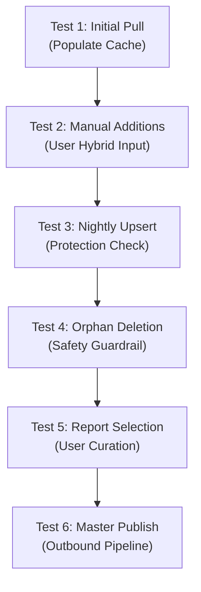

# Testing & Architecture Validation Protocol

This document outlines the testing strategy, test cases, and architectural validation framework for the Salesforce $\rightarrow$ SharePoint Weekly Report pipeline.

Use this guide to run your testing, log your results, and document proof that the **Single-Table Hybrid Staging Architecture** fulfills all business, performance, and data integrity goals.

---

## Primary Purpose & Success Criteria

The core purpose of this system is to **centralize, clean, and automate weekly reporting** while enabling seamless co-existence between:

1. Automated Salesforce semantic data.
2. Manual stakeholder updates (for deals/commentary not yet in SF).

### The 4 Pillars of Success

```
┌─────────────────────────────────────────────────────────────────────────┐
│                     ARCHITECTURAL SUCCESS PILLARS                       │
│                                                                         │
│  1. Data Protection        2. Hybrid Coexistence    3. Audit Integrity  │
│  Nightly batch NEVER       Salesforce data +        Source tracking     │
│  overwrites manual updates manual updates live      & deep links to SF  │
│  or user selections.       in one unified view.     for every record.   │
│                                                                         │
│                            4. Operational Efficiency                    │
│                            Zero flow calls on app load; app reads       │
│                            cached SharePoint data instantly.            │
└─────────────────────────────────────────────────────────────────────────┘
```

---

## 🧪 Step-by-Step Test Execution Plan

Run these **6 Test Scenarios** in order to validate your flows and database schema.



---

### Test Scenario 1: Initial Batch Execution (Data Ingestion)

* **Objective**: Verify that `RefreshSalesforceCache` queries the semantic model, executes the DAX queries via `QueryPowerBIDataset`, and populates `SalesOps_Staging` correctly.
* **Steps**:
  1. Trigger `RefreshSalesforceCache` manually in Power Automate.
  2. Inspect the run history of both child flows (`QueryPowerBIDataset` and `UpsertSFDataToStaging`).
  3. Open the `SalesOps_Staging` SharePoint list.
* **What to Look For**:
  - [ ] Rows created with `Source = "Salesforce"`.
  - [ ] `Section` correctly populated (`Wins/Losses` or `Opportunities/Updates`).
  - [ ] `SF_OpportunityId` populated.
  - [ ] `SF_Link` generated as a valid, clickable Salesforce URL.
  - [ ] `UpdateText` fallbacks working (showing `Won-Loss Reason`, `Comments`, or `Opportunity Name`).
  - [ ] Missing regions defaulting to `"Unassigned Region"`.

---

### Test Scenario 2: Manual User Entry (Hybrid Coexistence)

* **Objective**: Verify that users can add manual updates to the same list without interference.
* **Steps**:
  1. Manually add a new item directly in `SalesOps_Staging` (or via Power App):
     - `Title` (Region): `Canada`
     - `Section`: `Opportunities/Updates`
     - `CustomerName`: `Rogers Test Account`
     - `UpdateText`: `Manual update narrative test`
     - `Source`: `Manual`
     - `SF_OpportunityId`: *(Leave blank)*
* **What to Look For**:
  - [ ] Item saves successfully with `Source = "Manual"`.
  - [ ] Salesforce fields (`SF_OpportunityId`, `SF_Link`) remain empty without errors.

---

### Test Scenario 3: Nightly Refresh & Non-Destruction Check (Crucial)

* **Objective**: Prove that the nightly batch flow updates Salesforce records **without deleting or overwriting manual entries**.
* **Steps**:
  1. In Salesforce/Semantic model or `SalesOps_Staging`, modify a Salesforce-sourced row's update text.
  2. Run `RefreshSalesforceCache` again.
  3. Re-examine `SalesOps_Staging`.
* **What to Look For**:
  - [ ] **Salesforce Rows**: `UpdateText`, `Amount`, or `Stage` updated to latest values.
  - [ ] **Manual Rows**: `Rogers Test Account` (from Test 2) is **100% untouched and present**.
  - [ ] **No Duplicates**: No duplicate records created for existing `SF_OpportunityId`s.

---

### Test Scenario 4: Empty Payload Safety Guardrail

* **Objective**: Ensure that if the Power BI query returns 0 rows (e.g., network failure or dataset offline), existing cached data is preserved.
* **Steps**:
  1. Temporarily pass a DAX query that returns 0 rows into `QueryPowerBIDataset`.
  2. Run `UpsertSFDataToStaging`.
* **What to Look For**:
  - [ ] Flow finishes with `Status = Success` or skips deletion loop.
  - [ ] **Zero items deleted** in `SalesOps_Staging`. (Data cache is protected against service outages).

---

### Test Scenario 5: User Selection (`IncludeInReport`)

* **Objective**: Verify that users/analysts can curate which items appear in Friday's report.
* **Steps**:
  1. In `SalesOps_Staging`, check `IncludeInReport = Yes` for 2 Salesforce rows and 1 Manual row.
  2. Leave `IncludeInReport = No` for all other rows.
  3. Set `Status = Approved` for the checked rows.
* **What to Look For**:
  - [ ] `IncludeInReport` toggles independently without being reset by the batch flow.

---

### Test Scenario 6: Publish to Master (`WeeklyUpdates_Master_Final`)

* **Objective**: Verify that approved items from both sources compile into ready-to-print formatted text.
* **Steps**:
  1. Trigger `PublishSalesOpsToMaster` with `ReportDate = currentFriday`.
  2. Open `WeeklyUpdates_Master_Final`.
* **What to Look For**:
  - [ ] Only items with `Status = Approved` and `IncludeInReport = Yes` were copied.
  - [ ] Formatted string generated correctly: `CustomerName: UpdateText (Amount)`.
  - [ ] Original staging items marked as `Status = Published`.
  - [ ] Both `Source = Salesforce` and `Source = Manual` items published seamlessly.

---

## 📄 Test Results Log Template

Use this format to document your testing evidence for stakeholders:

```markdown
# Test Execution Log

**Date**: YYYY-MM-DD  
**Tester**: Luis Alarcon  
**Environment**: Americas-PU-Weekly-Report-Automation  

| Test # | Scenario Description | Expected Outcome | Actual Result | Status |
|:---|:---|:---|:---|:---|
| **T1** | Initial SF Batch Fetch | Pulls open/closed opps to SP | 14 items created | ✅ PASS |
| **T2** | Manual Item Creation | Manual row created with Source=Manual | Row created cleanly | ✅ PASS |
| **T3** | Nightly Upsert & Overwrite Check | Updates SF rows; preserves Manual rows | SF updated, Manual row intact | ✅ PASS |
| **T4** | Zero-Payload Guardrail | Empty query preserves cache | 0 rows deleted | ✅ PASS |
| **T5** | Report Curation | Flag items for weekly report | Flags saved | ✅ PASS |
| **T6** | Publish to Master | Compiles formatted bullets | 3 bullets in Master list | ✅ PASS |
```

---

## 🏛️ Architectural Validation: Why This Design Works

When presenting or validating this solution, reference these key architectural proofs:

### 1. Database Efficiency (3NF Compliance)

* **Single Table for Staging (`SalesOps_Staging`)**: Avoids table proliferation. Since Wins/Losses and Opp Updates share 100% identical attribute structures, storing them in one table with a `Section` discriminator avoids schema duplication.
* **Separate Config Table (`UserRegionConfig`)**: Prevents transitive dependencies (`User -> Region -> Role`). User permissions live in a dedicated reference table, maintaining Third Normal Form (3NF).

### 2. High Availability & Fast UI Response

* **Decoupled Architecture**: The Power App reads directly from SharePoint lists. Power Apps does **not** call backend flows on startup, ensuring 1-second load times regardless of Power BI or Salesforce API latency.
* **Nightly Staging Cache**: Serves as an operational cache. If Salesforce goes down during Friday report generation, the weekly report build is unaffected because the cache is locally available in SharePoint.

### 3. Change Management & Adoption Driver

* **Seamless Bridge to Salesforce Adoption**: Reps don't need to change their workflow overnight. Items missing in SF can be added manually in the app today, while the deep links (`SF_Link`) give users a 1-click path to update records in Salesforce for tomorrow.
